

  

<h1 align="center">여백 사용자 매뉴얼</h1>

  <strong>파일은 제자리에, 읽기는 내 속도로.</strong>

여백은 내 기기의 책을 편안하게 읽기 위한 앱입니다. 파일은 원래 폴더에 두고, 글과 화면을 나에게 맞추며, 다시 펼칠 때 읽던 자리로 돌아옵니다.

  <a href="https://github.com/poyal/yeobaek/releases/latest">앱 다운로드</a> ·
  <a href="#start">처음 시작하기</a> ·
  <a href="docs/screenshots/README.md">전체 화면 보기</a> ·
  <a href="https://github.com/poyal/yeobaek/issues">문의·오류 신고</a>

**Android 11 이상 · 회원 가입 없이 사용 · TXT·EPUB·PDF·이미지·만화 압축파일**

독서 기록과 설정은 기기에 저장합니다. 기기에 있는 파일은 원본에 접근할 수 있는 동안 인터넷 없이 읽을 수 있습니다. 클라우드 폴더에서 파일을 받거나 업데이트를 확인할 때는 인터넷이 필요합니다.

<table>
  <tr><th>책이 머무는 폴더</th><th>문장에 머무는 시간</th></tr>
  <tr><td><a href="docs/screenshots/35-library-reading.png">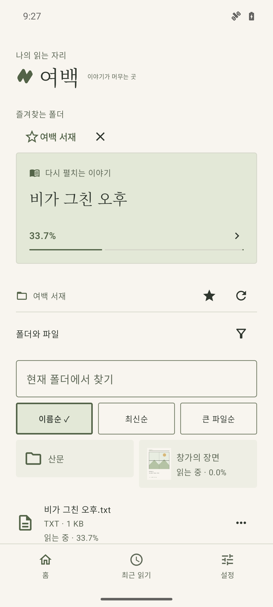</a></td><td><a href="docs/screenshots/05-txt-focus.png">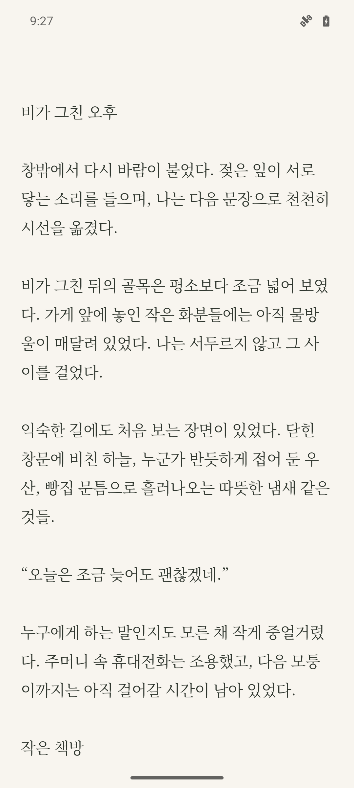</a></td></tr>
</table>

처음이라면 **설치 → 시작 폴더 선택 → 책 열기 → 읽기 설정 → 기록 백업** 순서로 따라 해 보세요. EPUB·설정 첫 화면·일반 설정은 **v0.4.0**, 기존 TXT·PDF·만화 사용 예시는 **v0.3.0**에서 촬영했습니다. v0.4.0은 설정 메뉴를 첫 화면으로 옮기고 카드 배경을 통일했습니다. 책과 그림은 사용법을 위한 창작 예제이며, 이미지를 누르면 크게 볼 수 있습니다.

**v1.0.0:** TXT에서 스와이프 후 멈췄다가 손을 뗄 때의 역방향 관성 스크롤 방어를 보완했습니다. [변경 사항](docs/releases/v1.0.0.md) · [검증 결과](docs/releases/1.0.0-verification.md) · [EPUB 상세 안내](docs/epub-reader.md)

## 목차

1. [설치하고 첫 책 열기](#start)
2. [폴더에서 책 찾기](#library)
3. [읽고, 다시 이어 읽기](#reading)
4. [TXT 읽기](#txt)
5. [EPUB 읽기](#epub)
6. [PDF 읽기](#pdf)
7. [이미지와 만화 읽기](#images)
8. [나에게 맞게 조절하기](#preferences)
9. [기록 보관과 기기 변경](#backup)
10. [업데이트와 저장 공간](#maintenance)
11. [막혔을 때 확인하기](#help)

## 설치하고 첫 책 열기

### 설치하기

1. 휴대폰에서 [앱 다운로드](https://github.com/poyal/yeobaek/releases/latest)를 엽니다.
2. 릴리즈의 **Assets**에서 이름이 `.apk`로 끝나는 설치 파일을 받습니다.
3. 다운로드한 파일을 엽니다. Android가 요청하면 파일을 연 앱의 **이 출처 허용**을 켜고 설치합니다. 기기에 따라 문구가 조금 다를 수 있습니다.
4. **여백**을 실행합니다. 계정이나 회원 가입은 필요하지 않습니다.

이미 사용 중이라면 기존 앱 위에 설치하세요. **앱을 삭제하면 내부 독서 기록과 설정도 지워집니다.** 삭제하거나 기기를 바꾸기 전에는 [독서 기록 백업](#backup)을 먼저 저장해 주세요.

### 책이 있는 폴더 연결하기

1. 휴대폰의 파일 앱에서 책 폴더를 만듭니다. 예를 들어 **다운로드 → 여백 서재** 안에 TXT·EPUB·PDF·이미지 또는 만화 압축파일을 넣습니다.
2. 여백의 **시작 폴더 선택**을 누릅니다.
3. Android 폴더 선택기에서 책 폴더 안으로 들어갑니다. **이 폴더 사용 → 허용**을 누릅니다.
4. 홈에서 읽을 파일을 누릅니다. 하위 폴더도 열어 볼 수 있습니다.

<table>
  <tr><th>시작 폴더 선택</th><th>이 폴더 사용</th></tr>
  <tr><td><a href="docs/screenshots/01-first-open.png">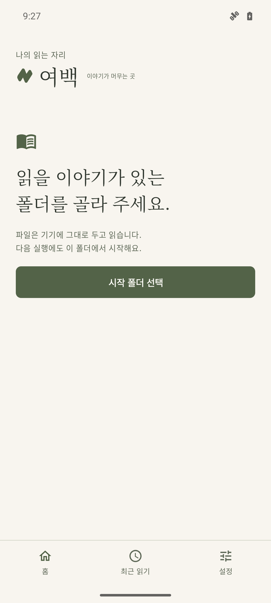</a></td><td><a href="docs/screenshots/02-folder-picker.png">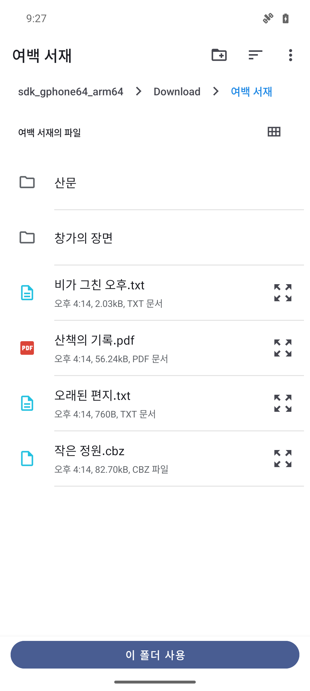</a></td></tr>
</table>

Android에서 저장소 최상위나 다운로드 폴더 자체를 선택하지 못하게 할 수 있습니다. 이때는 **그 안에 만든 책 폴더**를 선택하세요. 여백은 원본을 수정하거나 삭제하지 않으며, 읽기에 필요한 캐시는 따로 만듭니다.

## 폴더에서 책 찾기

| 메뉴 | 하는 일 |
| --- | --- |
| **홈** | 연결한 폴더와 하위 폴더에서 책 찾기, 최근 책 이어 읽기 |
| **최근 읽기** | 읽었던 책과 위치 확인, 다시 열기, 독서 기록 관리 |
| **설정** | 일반 설정, 형식별 뷰어 설정, 앱 정보·문의, 업데이트 |

홈의 **현재 폴더에서 찾기**에 파일 이름의 일부를 입력하세요. 검색은 현재 폴더에 적용하며 하위 폴더 전체를 한꺼번에 검색하지 않습니다. **이름순·최신순·큰 파일순**으로 정렬하고, 검색창의 **×**로 검색어를 지울 수 있습니다.

폴더 이름 옆 **별**을 누르면 즐겨찾는 폴더에 등록합니다. 즐겨찾기로 다른 폴더를 열어도 시작 폴더는 바뀌지 않습니다. 읽었던 파일에는 **읽는 중·진행률** 또는 **완독** 상태가 표시됩니다.

<table>
  <tr><th>현재 폴더에서 찾기</th><th>최근 읽기</th></tr>
  <tr><td><a href="docs/screenshots/17-folder-search.png">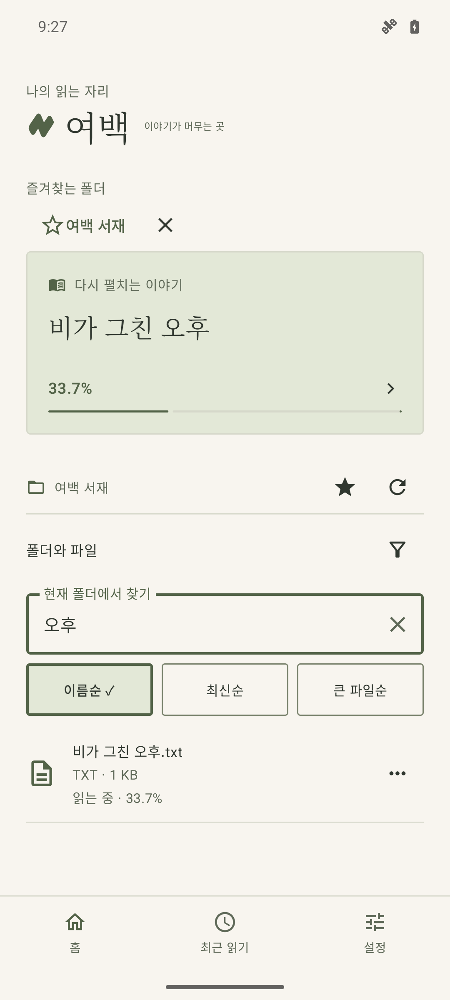</a></td><td><a href="docs/screenshots/16-recent.png">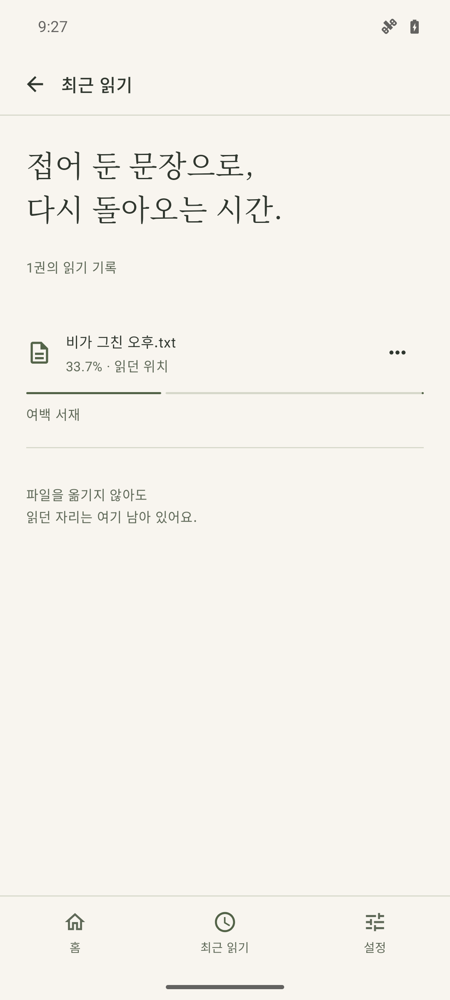</a></td></tr>
</table>

파일을 추가했는데 목록에 보이지 않으면 **새로고침**을 누르세요. 표시 필터가 켜져 있다면 **필터 아이콘**으로 모든 파일 표시를 확인합니다. 시작 폴더는 **설정 → 일반 설정 → 폴더와 저장 공간 → 시작 폴더**에서 바꿉니다.

파일 앱의 **다른 앱으로 열기 → 여백**으로 지원 파일을 바로 열 수도 있습니다. 다른 앱에서 전달한 이미지 한 장은 독립된 문서로 열며, 같은 폴더의 다른 이미지까지 자동으로 가져오지는 않습니다.

## 읽고, 다시 이어 읽기

### 읽기 화면의 기본 조작

- **본문을 짧게 한 번 누르기:** 위아래 메뉴를 함께 숨기거나 다시 표시합니다. 스크롤과 길게 누르기는 별도 동작입니다.
- **위쪽 책갈피 아이콘:** 현재 위치의 책갈피를 추가하거나 해제합니다.
- **아래쪽 이동:** 위치를 고른 뒤 적용합니다. 닫거나 취소하면 읽던 위치를 유지합니다.
- **아래쪽 책갈피:** 저장한 위치로 이동하거나 필요 없는 책갈피를 삭제합니다.
- **아래쪽 설정:** 현재 읽는 형식의 설정을 엽니다. EPUB은 전체 설정으로 바로 이동합니다.

<table>
  <tr><th>독서 메뉴</th><th>읽기 위치 이동</th></tr>
  <tr><td><a href="docs/screenshots/04-txt-reader.png">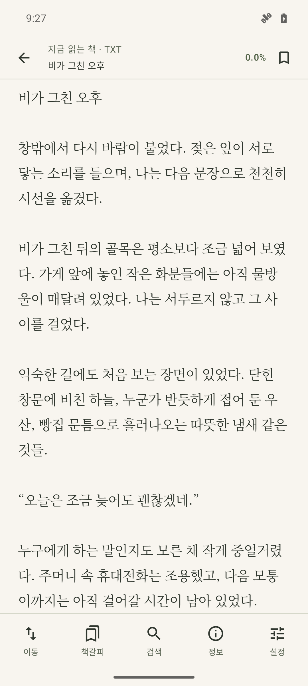</a></td><td><a href="docs/screenshots/06-move.png">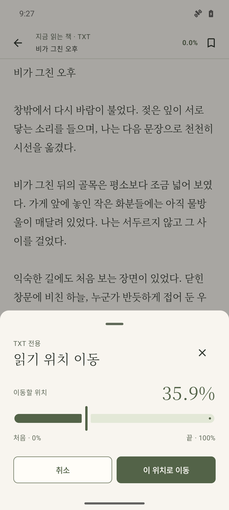</a></td></tr>
</table>

TXT는 진행률로, PDF와 이미지는 페이지 번호로 이동합니다. EPUB은 **목차**와 이전·다음 버튼으로 이동합니다. TXT·EPUB·PDF에는 **검색**, PDF·이미지에는 **색상 반전**, TXT에는 인코딩을 확인하는 **정보** 메뉴가 있습니다.

### 읽던 자리로 돌아오기

독서 중 앱을 닫았다가 새로 실행하면 **이어서 읽기 / 폴더 보기**를 선택할 수 있습니다. **이어서 읽기**는 원본 파일을 확인하고 저장한 위치를 엽니다. **폴더 보기**를 선택해도 독서 기록은 남습니다.

독서 화면의 뒤로 가기로 폴더에 돌아온 뒤 앱을 종료하면, 다음 실행은 설정한 시작 폴더에서 시작합니다. 읽었던 책은 **최근 읽기**에서 다시 열 수 있습니다.

<table>
  <tr><th>다음 실행에서 이어 읽기</th><th>남겨 둔 책갈피</th></tr>
  <tr><td><a href="docs/screenshots/15-resume.png">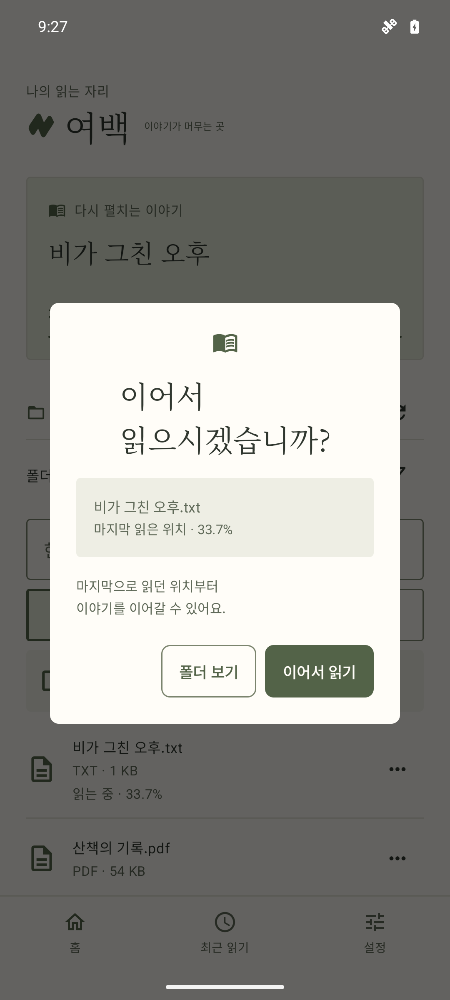</a></td><td><a href="docs/screenshots/07-bookmarks.png">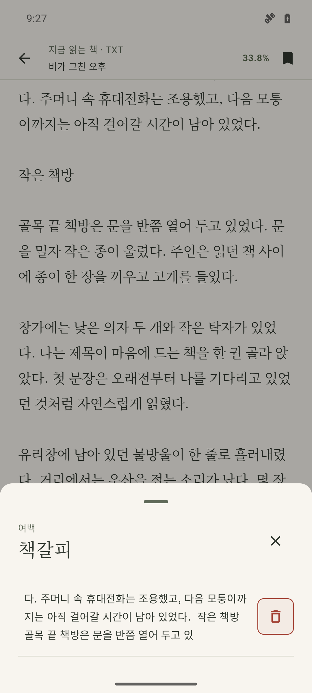</a></td></tr>
</table>

책 끝에 도달하면 **다음 것 보기 / 나가기**가 나타납니다. 현재 폴더의 정렬 순서에 따라 다음 책을 열며, 다음 항목이 없으면 나가기만 표시합니다. 이미지 폴더 전체는 한 권으로 취급합니다. 안내를 뒤로 닫으면 마지막 내용을 계속 볼 수 있습니다.

<a href="docs/screenshots/37-reading-end.png">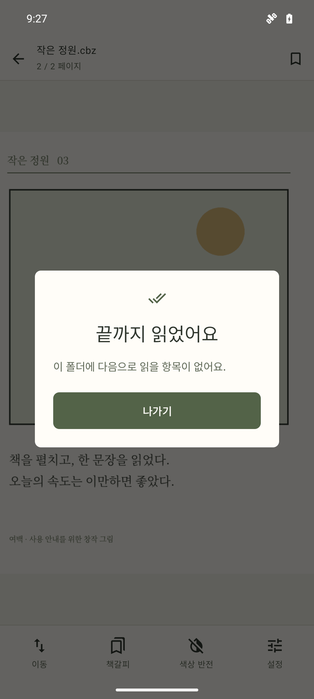</a>

## TXT 읽기

### 글과 간격 조절하기

1. 책을 열고 아래쪽 **설정**을 누릅니다.
2. 위에서 **공통·이 폴더·이 책** 중 적용할 범위를 고릅니다. 한 권만 바꾸려면 **이 책**을 선택하세요.
3. 글자 크기의 **− / +**, **글꼴**, **라이트·세피아·다크**를 조절합니다.
4. **자세한 읽기 설정**에서 미리보기를 보며 글꼴·굵기, 줄간격, 좌우 여백을 바꿉니다.

<table>
  <tr><th>이 책에만 빠르게 조절</th><th>자세한 읽기 설정</th></tr>
  <tr><td><a href="docs/screenshots/09-quick-settings.png">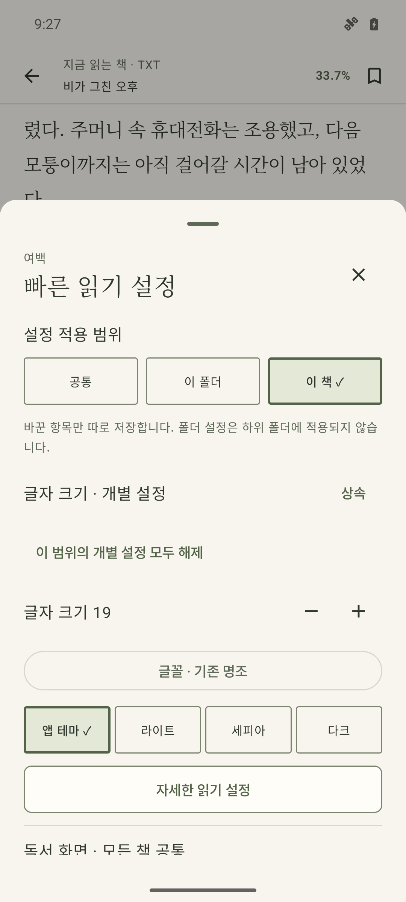</a></td><td><a href="docs/screenshots/10-txt-settings.png">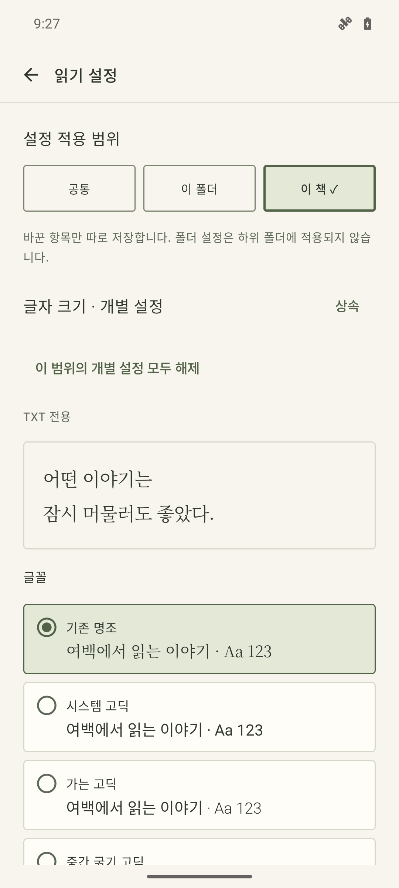</a></td></tr>
</table>

글자 크기는 14~32, 줄간격은 1.3~2.1, 좌우 여백은 16~40 범위에서 조절합니다. 시스템 글꼴은 기기의 한글 대체 글꼴에 따라 일부 선택지가 비슷하게 보일 수 있습니다. 설정의 적용 범위와 **상속**은 [나에게 맞게 조절하기](#preferences)에서 설명합니다.

### 문장 찾기

1. 아래쪽 **검색**을 누르고 찾을 문장을 입력합니다.
2. **검색**을 누르면 결과 수와 문장 목록을 확인할 수 있습니다.
3. 결과 문장 또는 **이전·다음**으로 이동합니다.
4. 탐색을 마치고 검색을 시작하기 전 자리로 돌아가려면 **원래 위치로**를 누릅니다.

<table>
  <tr><th>검색어와 결과 문장</th></tr>
  <tr><td><a href="docs/screenshots/08-txt-search.png">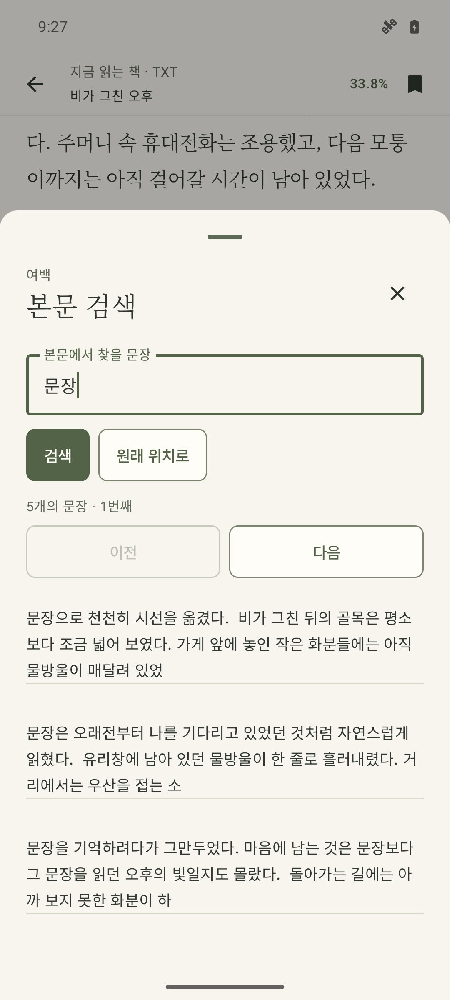</a></td></tr>
</table>

### 글자가 깨져 보일 때

**정보 → 글자가 깨져 보이나요?**를 엽니다. UTF-8·CP949·EUC-KR·UTF-16 LE/BE 중 하나를 고르고, 미리보기의 한글이 올바른지 확인한 뒤 **이 인코딩 적용**을 누릅니다. 이 선택은 현재 책에만 적용합니다.

<a href="docs/screenshots/14-encoding.png">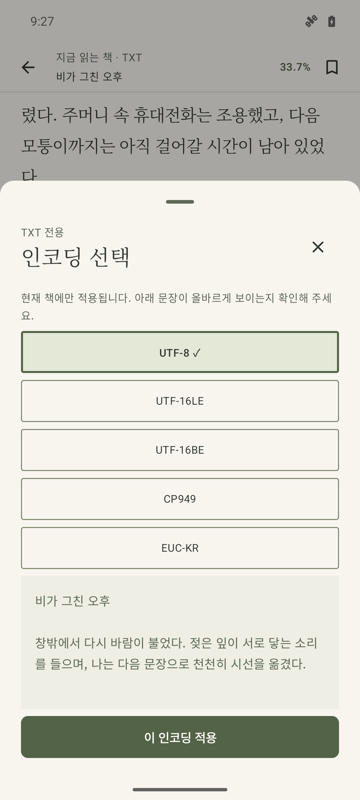</a>

## EPUB 읽기

일반 EPUB 2·3과 **DRM 없는 구매 EPUB**을 폴더에서 열거나 파일 앱의 **다른 앱으로 열기 → 여백**으로 엽니다. DRM이 있는 파일은 보호 안내를 표시합니다.

- **일반 본문:** 한 장 안에서 세로로 읽습니다. 이전·다음 버튼이나 좌우 스와이프로 장을 바꾸고, 설정에서 **페이지 넘김**으로 전환할 수 있습니다.
- **고정 지면:** 한 페이지씩 넘기며 두 손가락으로 확대·이동합니다. 다시 열면 같은 페이지를 화면에 맞춰 보여 줍니다.
- **목차·검색·책갈피:** 원하는 위치로 이동합니다. 검색 패널의 **원래 위치로**, 내부 링크 이동 뒤 **이전 위치**로 읽던 곳에 돌아옵니다. 텍스트를 길게 눌러 선택·복사할 수 있습니다.
- **설정:** 공통·이 폴더·이 책 범위를 고르고 글꼴·크기·본문 색상을 바꿉니다. **원본 서식**을 끄면 줄 간격·여백도 조절합니다. 고정 지면은 바깥 배경만 변경합니다.

<table>
  <tr><th>EPUB 본문</th><th>EPUB 읽기 설정</th></tr>
  <tr><td><a href="docs/screenshots/0.4.0/epub-reader.png">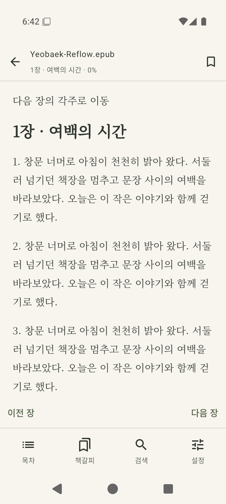</a></td><td><a href="docs/screenshots/0.4.0/epub-settings.png">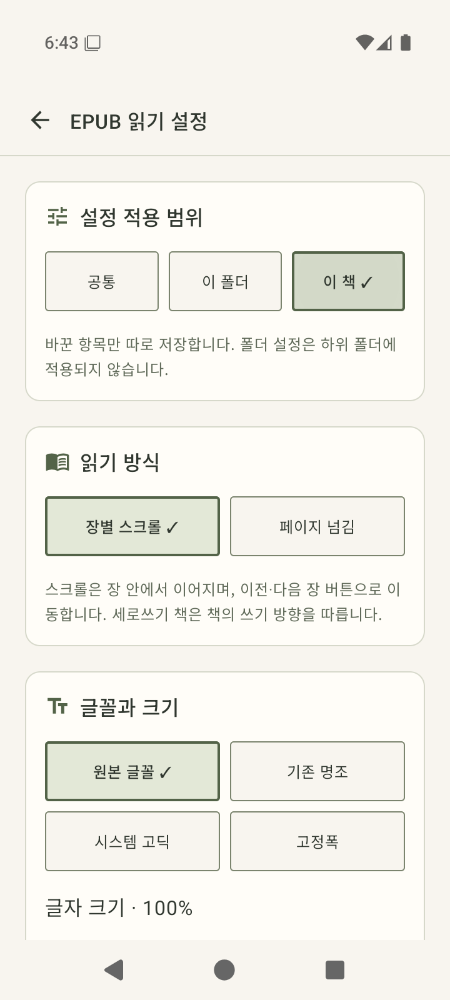</a></td></tr>
</table>

원본 파일이 바뀌면 **처음부터 열기 / 취소**를 선택합니다. 이전 위치와 책갈피는 보관하며 다른 내용의 위치로 자동 이동하지 않습니다. 이미지로만 된 책에는 검색·선택할 텍스트가 없을 수 있습니다. [지원 범위와 저장 방식](docs/epub-reader.md)

## PDF 읽기

PDF는 원래 문서의 배치를 유지하며 세로로 이어 읽습니다. 두 손가락을 벌리거나 두 번 눌러 확대하고, **설정 → 너비에 맞춤 / 페이지에 맞춤**으로 보기 방식을 고릅니다.

| 원하는 작업 | 방법 |
| --- | --- |
| 특정 페이지로 가기 | **이동**에서 페이지 번호를 입력하고 **이 페이지로 이동** |
| 문장 찾기 | **검색**에서 검색어 입력 → **검색** → 결과 선택 또는 이전·다음 |
| 문장 복사하기 | 텍스트가 있는 곳을 길게 눌러 선택한 뒤 **복사** |
| 읽던 페이지 남기기 | 위쪽 책갈피 아이콘으로 저장, 아래쪽 **책갈피**로 다시 열기 |
| 밝은 페이지 반전하기 | 아래쪽 **색상 반전** 또는 빠른 설정의 색상 반전 |

<table>
  <tr><th>문서의 배치 그대로</th><th>PDF에서 문장 찾기</th></tr>
  <tr><td><a href="docs/screenshots/18-pdf-reader.png">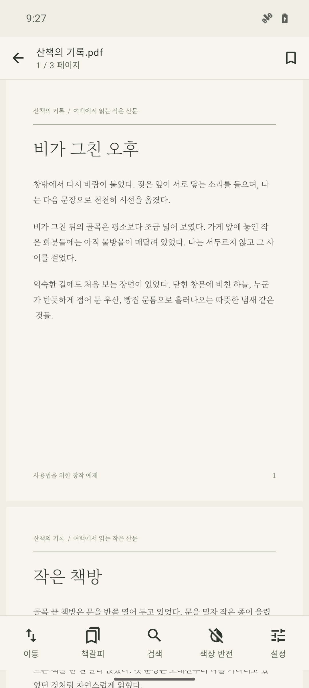</a></td><td><a href="docs/screenshots/20-pdf-search.png">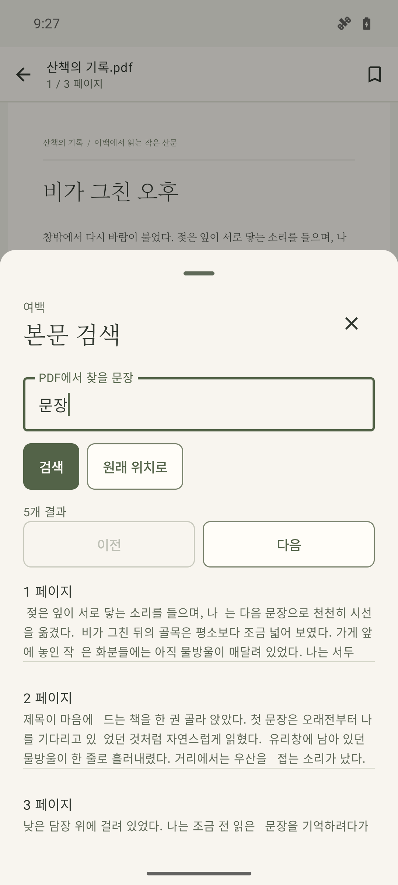</a></td></tr>
</table>

**색상 반전은 사진·도표를 포함한 페이지 전체에 적용**하며 원본은 바꾸지 않습니다. 스캔한 PDF는 읽을 수 있지만 OCR이 없어 이미지 속 글자를 검색·선택·복사할 수 없습니다. PDF의 글꼴·줄간격은 TXT처럼 바꾸지 않습니다.

## 이미지와 만화 읽기

### 폴더나 압축파일 열기

- **이미지 폴더:** 폴더 안의 이미지를 누르면 그 파일부터 같은 폴더의 이미지들을 이어 읽습니다.
- **만화 압축파일:** ZIP/CBZ·RAR/CBR·7Z/CB7을 누르면 내부 하위 폴더까지 한 권으로 엽니다.
- 파일 이름의 숫자 순서대로 정렬합니다. 예를 들어 `2`가 `10`보다 먼저 나옵니다.

**설정**에서 **세로 연속 / 좌우 넘김**, **왼쪽부터 / 오른쪽부터**, 화면 맞춤을 고릅니다. **자세한 읽기 설정**에는 한 쪽·두 쪽·가로 화면 자동 배치와 표지를 한 쪽으로 보는 옵션도 있습니다.

<table>
  <tr><th>폴더 속 이미지 읽기</th><th>썸네일로 장면 찾기</th></tr>
  <tr><td><a href="docs/screenshots/34-image-folder.png">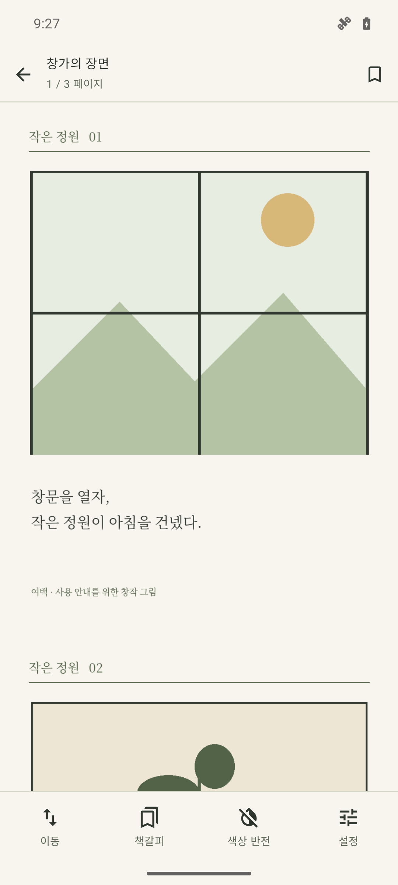</a></td><td><a href="docs/screenshots/25-thumbnails.png">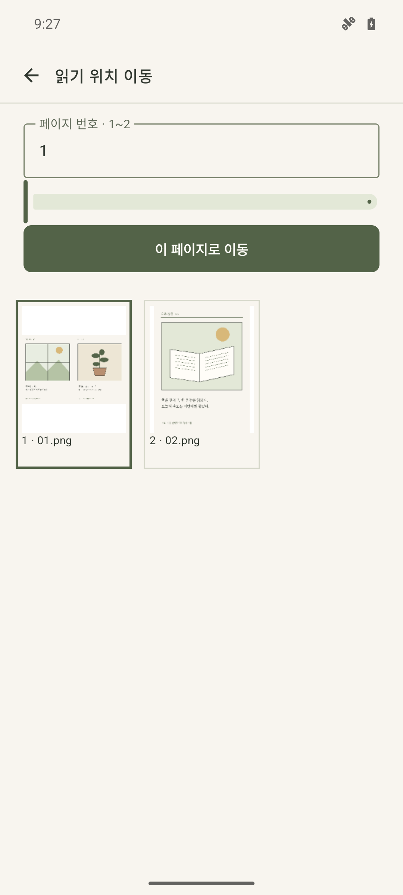</a></td></tr>
</table>

**이동**을 누르면 페이지 번호와 썸네일로 원하는 장면을 찾습니다. 압축파일에 하위 폴더가 있다면 폴더별 목차도 사용할 수 있습니다. 확대·책갈피·이어 읽기와 색상 반전도 지원합니다.

### 펼침면을 반쪽씩 읽기

1. 휴대폰을 세로로 놓고 **설정 → 좌우 넘김**을 선택합니다.
2. **펼침면 반쪽씩 읽기**를 켭니다.
3. 가로로 긴 페이지가 읽기 방향에 따라 반쪽씩 표시됩니다. 한 번 넘기면 같은 페이지의 나머지 반쪽으로 이어집니다.

<table>
  <tr><th>펼침면 전체</th><th>같은 페이지 · 왼쪽</th><th>같은 페이지 · 오른쪽</th></tr>
  <tr><td><a href="docs/screenshots/21-comic-spread.png">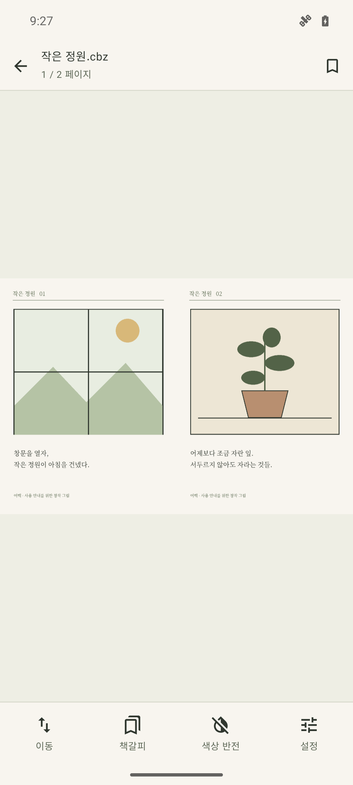</a></td><td><a href="docs/screenshots/22-comic-left.png">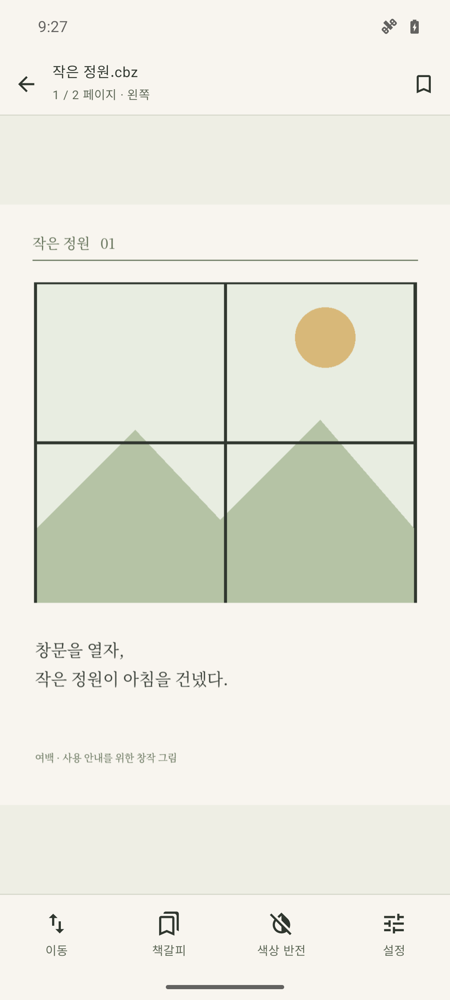</a></td><td><a href="docs/screenshots/23-comic-right.png">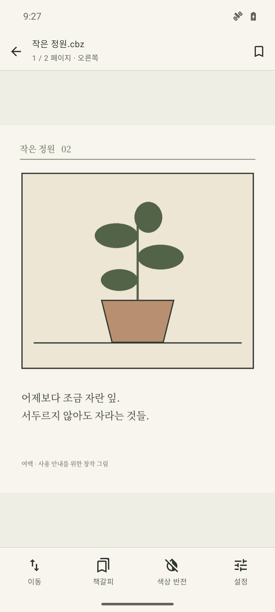</a></td></tr>
</table>

위쪽에는 원래 페이지 번호와 **왼쪽·오른쪽**이 함께 표시됩니다. 읽던 위치와 책갈피도 어느 반쪽인지 함께 기억합니다. 세로 연속 모드에서는 펼침면 분할을 적용하지 않습니다.

### 가장자리 여백 줄이기

**설정 → 자동 여백 자르기**를 켜거나 **여백 직접 조절**을 누릅니다. 직접 조절할 때는 미리보기를 보며 가장자리를 바꾸고, 책 전체 또는 현재 페이지만 적용할지 고른 뒤 **자르기 적용**을 누르세요. **자르기 없이 보기**로 전체를 다시 볼 수 있습니다. 원본 이미지는 수정하지 않습니다.

<a href="docs/screenshots/24-crop.png">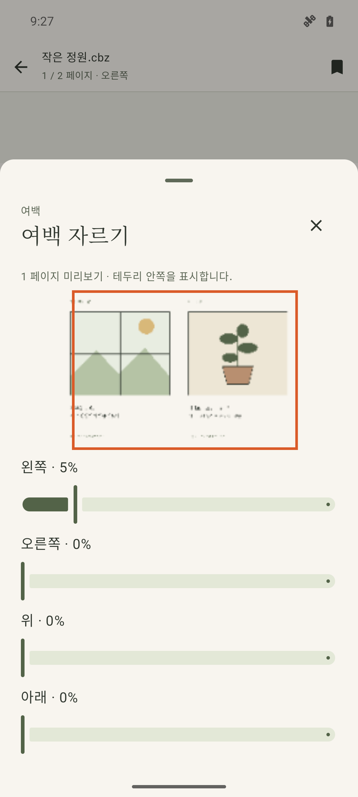</a>

## 나에게 맞게 조절하기

설정 첫 화면에서 **TXT·EPUB·PDF·이미지 뷰어**로 바로 들어갑니다. 앱 테마·기록 백업·저장 공간은 **일반 설정**에서 관리합니다.

<table>
  <tr><th>형식별 설정 바로가기</th><th>일반 설정과 기록 백업</th></tr>
  <tr><td><a href="docs/screenshots/0.4.0/settings-main.png">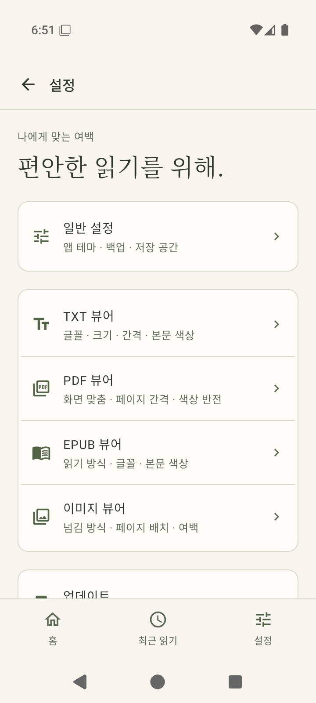</a></td><td><a href="docs/screenshots/0.4.0/settings-general.png">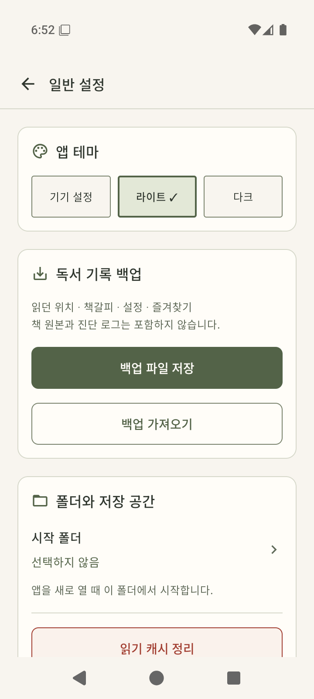</a></td></tr>
</table>

### 설정을 어디까지 적용할지 고르기

| 범위 | 적용되는 곳 |
| --- | --- |
| **공통** | 해당 형식의 기본 읽기 설정 |
| **이 폴더** | 현재 책이 속한 바로 위 폴더. 하위 폴더에 자동 전파하지 않음 |
| **이 책** | 지금 읽는 책 한 권 |

설정은 **이 책 → 바로 위 폴더 → 해당 형식의 공통값** 순서로 적용됩니다. 바꾼 항목만 따로 저장합니다. 예를 들어 이 책의 글자 크기만 바꾸면 글꼴과 본문 색상은 기존 공통·폴더 설정을 계속 따릅니다.

항목 옆 **상속**을 누르면 그 항목의 개별 설정을 해제하고 상위 범위의 값을 따릅니다. **이 범위의 개별 설정 모두 해제**는 선택한 범위의 개별 설정을 함께 해제합니다. TXT·EPUB·PDF·이미지 설정은 형식별로 따로 관리합니다.

### 앱 테마와 본문 색상

**설정 → 일반 설정 → 앱 테마**에서 **기기 설정·라이트·다크**를 고릅니다. TXT와 일반 EPUB 본문은 각 읽기 설정에서 별도로 **앱 테마·라이트·세피아·다크**를 선택합니다. 본문을 세피아나 다크로 고정하면 앱 테마가 바뀌어도 그 선택을 유지합니다.

<table>
  <tr><th>세피아 본문</th><th>다크 본문</th><th>다크 앱 테마</th></tr>
  <tr><td><a href="docs/screenshots/11-sepia.png">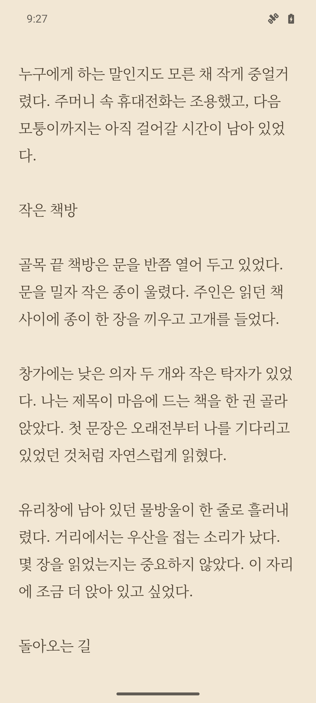</a></td><td><a href="docs/screenshots/12-dark-reader.png">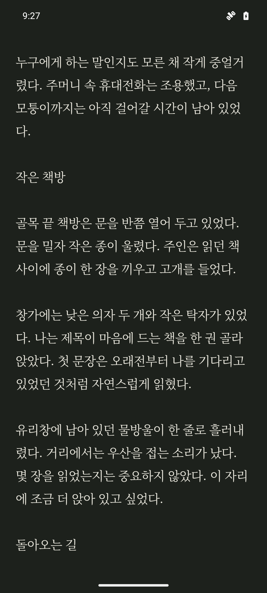</a></td><td><a href="docs/screenshots/36-dark-library.png">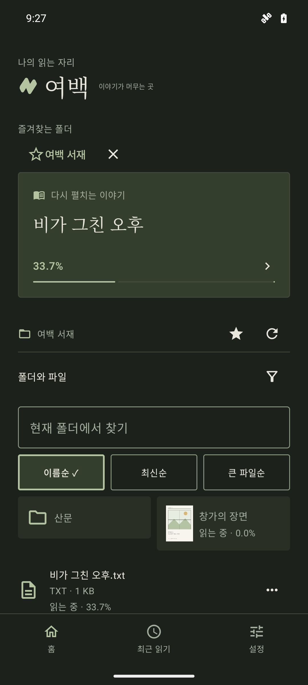</a></td></tr>
</table>

### 독서 중 밝기·회전·화면 유지

TXT·PDF·이미지의 빠른 설정 아래쪽 **독서 화면 · 모든 책 공통**에서 조절합니다. 정한 값은 EPUB에도 적용됩니다.

- **시스템 밝기 사용**을 끄면 독서 화면의 밝기를 직접 정합니다.
- **자동 회전·세로·가로** 중 원하는 방향을 고릅니다.
- **읽는 동안 화면 켜두기**로 독서 중 화면이 꺼지지 않게 합니다.

이 설정은 모든 형식의 독서 화면에서 사용합니다.

<a href="docs/screenshots/13-screen-controls.png">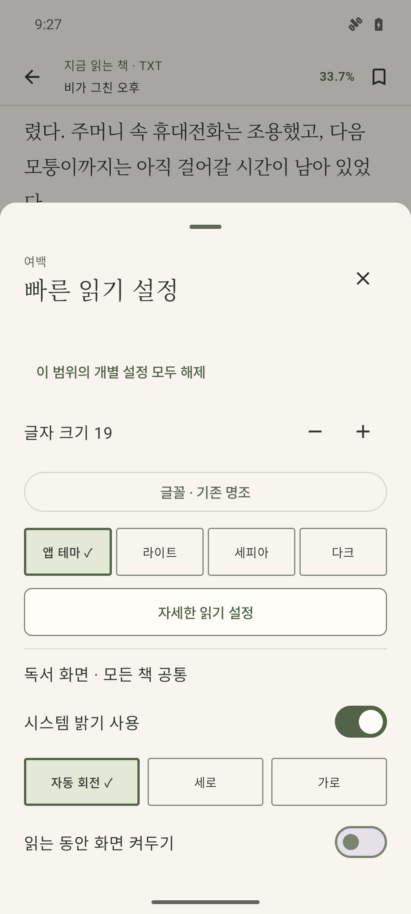</a>

## 기록 보관과 기기 변경

### 백업 파일 저장하기

1. **설정 → 일반 설정 → 독서 기록 백업**으로 이동합니다.
2. **백업 파일 저장**을 누릅니다.
3. Android 저장기에서 보관할 폴더를 골라 JSON 파일을 저장합니다.
4. 기기를 바꾸기 전에는 백업 파일과 책 원본을 새 기기로 각각 옮깁니다.

백업에는 **읽던 위치·책갈피·설정·즐겨찾기**가 들어갑니다. v0.4.0은 EPUB 기록을 포함한 버전 2 백업을 저장하며 기존 버전 1 백업도 가져옵니다. **책 원본·캐시·진단 로그·Android 파일 접근 권한은 포함하지 않습니다.** 자동 동기화나 자동 백업 기능은 제공하지 않습니다.

### 기록 가져오기

1. 같은 메뉴에서 **백업 가져오기**를 누르고 저장한 JSON 파일을 선택합니다.
2. 책·위치·책갈피 수와 기존 기록과 겹치는 책 수를 확인합니다.
3. **없는 기록 추가**를 누릅니다. 기존 값은 유지하면서 없는 기록을 추가합니다.

<table>
  <tr><th>독서 기록 백업</th><th>겹치는 기록 확인</th></tr>
  <tr><td><a href="docs/screenshots/26-backup.png">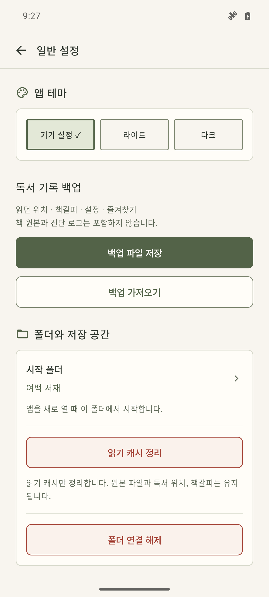</a></td><td><a href="docs/screenshots/27-restore-preview.png">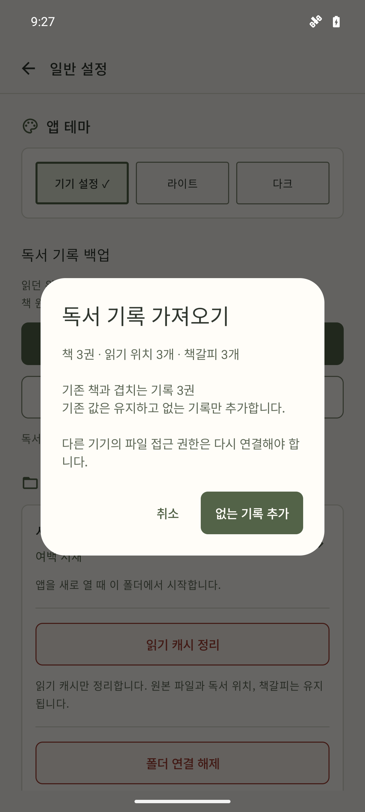</a></td></tr>
</table>

### 새 기기에서 원본 다시 연결하기

복원 뒤 **최근 읽기**에서 책을 엽니다. 접근할 수 없다는 안내가 나오면 **파일 다시 찾기**를 누르고, 옮겨 둔 동일한 원본 파일을 선택하세요. 기록을 유지하면서 새 파일 위치에 연결합니다. 홈의 시작 폴더도 새 기기에서 다시 선택해 주세요.

<table>
  <tr><th>새 환경에 기록 가져오기</th><th>원본 파일 다시 찾기</th></tr>
  <tr><td><a href="docs/screenshots/28-fresh-restore.png">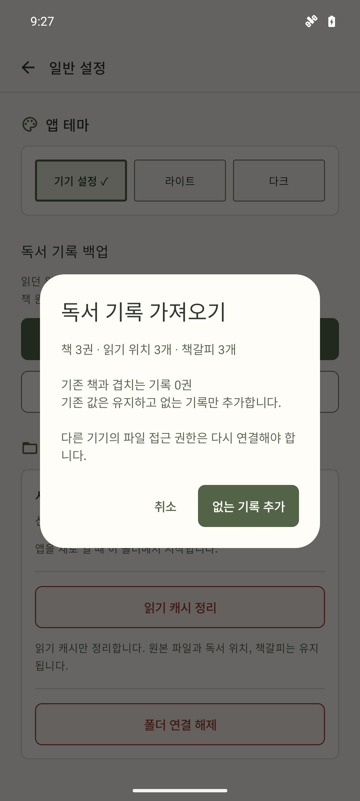</a></td><td><a href="docs/screenshots/29-reconnect.png">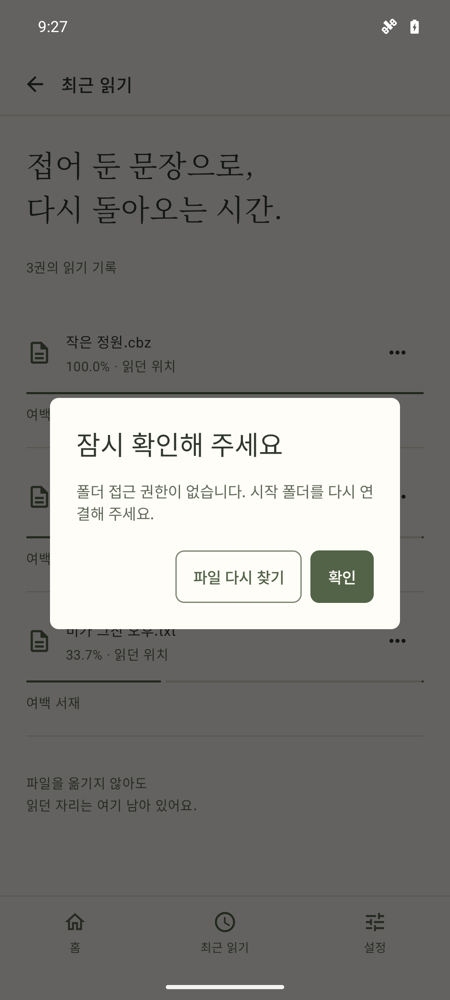</a></td></tr>
</table>

## 업데이트와 저장 공간

### 업데이트하기

1. **설정 → 업데이트**에서 최신 공개 버전을 확인합니다.
2. 새 버전이 있으면 APK를 내려받습니다. 파일은 **Download** 폴더에 저장합니다.
3. **업데이트 설치**를 누릅니다. Android가 요청하면 여백의 **이 출처의 앱 설치 허용**을 켠 뒤 설치 버튼을 다시 누릅니다.
4. 기존 앱을 삭제하지 않고 업데이트합니다.

새 실행의 자동 확인은 하루 한 번이며 수동 확인도 가능합니다. 연결에 실패하면 상태를 확인하고 나중에 다시 시도하세요. 다운로드한 파일은 설치가 끝나거나 취소되어도 자동으로 삭제하지 않습니다.

여백은 다운로드한 APK의 크기·체크섬과 설치 대상·버전·서명을 확인합니다. 업데이트 통신에는 책 본문·책갈피·독서 기록을 포함하지 않습니다.

### 폴더·캐시·기록 정리하기

| 원하는 작업 | 메뉴와 결과 |
| --- | --- |
| 시작 폴더 변경 | **설정 → 일반 설정 → 폴더와 저장 공간 → 시작 폴더** |
| 읽기 캐시 정리 | 같은 화면의 **읽기 캐시 정리**. 다시 만들 수 있는 읽기 캐시를 지우며 원본·위치·책갈피는 유지 |
| 폴더 연결 해제 | 같은 화면의 **폴더 연결 해제 → 연결 해제 확인**. 원본과 독서 기록은 유지 |
| 한 권의 독서 기록 삭제 | **최근 읽기 → 해당 책의 ⋯ → 독서 기록 삭제**. 위치·책갈피를 삭제하며 원본은 유지 |

<table>
  <tr><th>버전과 업데이트 확인</th><th>폴더와 저장 공간</th></tr>
  <tr><td><a href="docs/screenshots/33-update.png">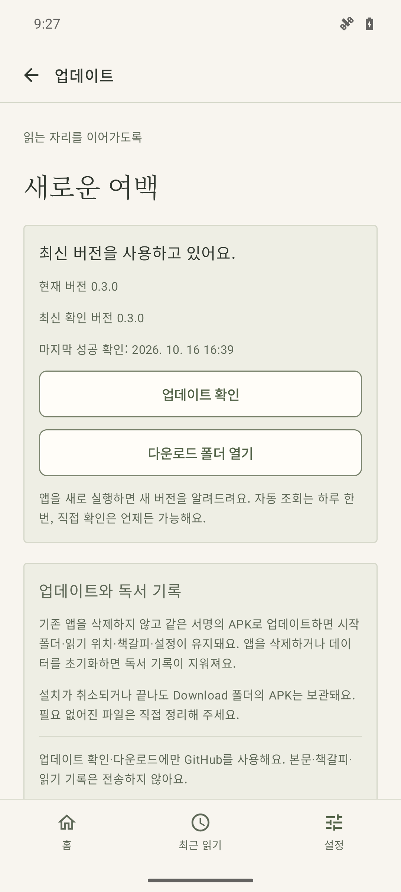</a></td><td><a href="docs/screenshots/32-storage.png">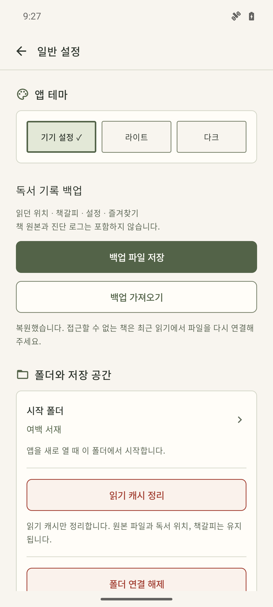</a></td></tr>
</table>

## 막혔을 때 확인하기

| 상황 | 확인할 내용 |
| --- | --- |
| 파일을 넣었는데 보이지 않아요 | 연결한 폴더와 현재 하위 폴더를 확인하고 새로고침하세요. 파일명 검색어와 표시 필터도 확인하세요. |
| 폴더를 선택할 수 없어요 | 저장소 최상위 대신 그 안의 책 폴더를 선택하세요. 다운로드 폴더 안에 별도 폴더를 만들어도 됩니다. |
| Android 11에서 폴더 선택 버튼이 안 보여요 | AOSP 파일 선택기가 이전 폴더를 복원할 때 버튼이 사라지는 경우를 관찰했습니다. 파일 앱의 **다른 앱으로 열기 → 여백**으로 책을 열 수 있습니다. [확인한 환경과 제약](docs/releases/0.4.0-verification.md)을 참고하세요. |
| 한글이 깨져 보여요 | **정보 → 글자가 깨져 보이나요?**에서 인코딩별 미리보기를 확인하고 적용하세요. |
| 읽던 책을 열 수 없어요 | 파일을 옮기거나 이름을 바꿨는지, 원본이 삭제됐는지 확인하세요. **파일 다시 찾기**로 동일한 원본을 연결할 수 있습니다. |
| 인터넷 없이 읽을 수 없어요 | 원본이 클라우드에만 있으면 공급자의 다운로드가 필요할 수 있습니다. 읽기 캐시는 영구 보관용 원본 사본이 아닙니다. |
| PDF에서 검색이 안 돼요 | 스캔 이미지에는 검색할 텍스트가 없을 수 있습니다. OCR은 제공하지 않습니다. |
| 만화가 반쪽으로 나뉘지 않아요 | **세로 화면·좌우 넘김·가로로 긴 페이지**에서 펼침면 분할을 사용하세요. |
| 본문 색상이 앱 테마와 달라요 | TXT·일반 EPUB 본문 색상을 **앱 테마**로 바꾸면 앱 테마를 따릅니다. |
| 가져온 기록이 기존 값을 바꾸지 않아요 | 가져오기는 기존 값을 유지하고 없는 기록만 추가합니다. 덮어쓰는 복원이 아닙니다. |
| 파일 준비에 시간이 걸려요 | 큰 파일이나 압축 방식에 따라 준비가 필요합니다. 준비 화면에서 취소할 수 있습니다. |

### 지원하는 파일과 현재 범위

| 형식 | 지원 범위 |
| --- | --- |
| TXT | UTF-8·UTF-16 LE/BE·CP949·EUC-KR. 원본 최대 **100MiB** |
| EPUB | DRM 없는 EPUB 2·3, 일반 본문·고정 지면, 목차·검색·선택·책갈피·이어 읽기 |
| PDF | 세로 연속 읽기, 확대·페이지 이동, 텍스트 검색·선택·복사, 책갈피·이어 읽기·색상 반전 |
| 이미지 | JPG/JPEG·PNG·WebP·BMP·GIF의 첫 프레임 |
| 압축파일 | ZIP/CBZ·RAR/CBR·7Z/CB7 내부의 지원 이미지 |

EPUB의 DRM 해제·서점 로그인·ACSM/LCP·오디오/비디오·책의 스크립트·외부 웹 리소스는 지원하지 않습니다. TTS·자동 스크롤·클라우드 동기화·TXT 자동 목차·사용자 글꼴 가져오기는 제공하지 않습니다. PDF의 암호 문서·편집·주석·서명·좌우 넘김·두 쪽 보기도 지원하지 않습니다. 이미지 OCR·편집, 암호 압축·분할 압축·압축 속 압축은 지원하지 않습니다.

### 문제를 알려 주실 때

**설정 → 앱 정보·문의**에서 이메일·GitHub·오류 신고·변경 내역을 확인할 수 있습니다. [오류 신고](https://github.com/poyal/yeobaek/issues)에 앱 버전, Android 버전, 파일 형식, 문제를 재현하는 순서와 발생 시각을 적어 주세요.

스크롤 문제는 **설정 → 앱 정보·문의 → 스크롤 진단 로그 저장**으로 저장한 파일을 함께 전달하면 확인에 도움이 됩니다. 로그는 기기에 최대 128MiB로 순환 보관하며 책 이름·본문·검색어는 기록하지 않습니다. 자동으로 외부에 전송하지 않습니다. 공유할 화면에 개인 책이나 경로가 포함되어 있는지도 확인해 주세요.

강제 종료 직전의 마지막 약 1초 위치는 저장되지 않을 수 있습니다. 실물 기기의 성능·발열과 TalkBack 실제 발화는 아직 별도 확인이 필요합니다. 버전별 검사 환경과 남은 사항은 [릴리즈 검증 기록](docs/releases/1.0.0-verification.md)에 정리되어 있습니다.

## 문서와 제작

- [전체 화면과 촬영 조건](docs/screenshots/README.md) · [v1.0.0 변경 사항](docs/releases/v1.0.0.md)
- [개발·빌드·검증 안내](docs/implementation.md) · [설계 문서 목차](docs/README.md) · [개발 계획](plan.md)
- [종이의 여백 × 리듬 디자인](design/final/README.md) · [이전 시안](design/archive/README.md)

내장 명조 글꼴은 Noto Serif CJK KR이며 [SIL Open Font License](app/src/main/assets/licenses/NotoSerifCJK-OFL.txt)를 함께 제공합니다. PDF·압축·EPUB 엔진의 라이선스와 구성요소 고지도 [앱 라이선스 자산](app/src/main/assets/licenses/)에 포함되어 있습니다.
