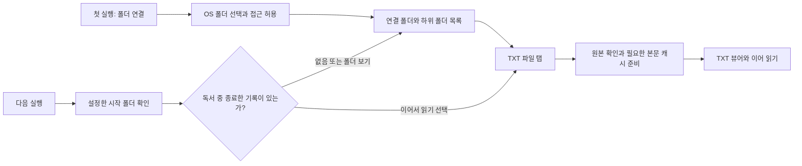

# 폴더 연결과 서재 설계

작성일: 2026-10-13. 사용자가 선택한 OS 폴더를 기억하고 그 안의 파일을 여는 방식입니다. 첫 버전은 **기본 폴더 1개 연결 + 하위 폴더 탐색 + TXT 열기**를 구현합니다.

## 1. 사용 흐름



폴더 연결은 앱 공통 기능입니다. TXT·PDF·이미지/만화는 같은 폴더 목록에서 자기 형식의 파일을 받아 엽니다. 원본은 선택한 저장소에 두고 앱에는 연결 정보·읽기 기록·필요한 캐시를 저장합니다. 폴더를 연결할 때 모든 파일을 복사하거나 인코딩 분석하지 않습니다.

앱을 새로 실행하면 **앱 설정에서 지정한 시작 폴더**를 기본 화면으로 엽니다. 마지막에 탐색한 하위 폴더가 시작 폴더를 자동 변경하지 않습니다. 이전 실행에서 책을 읽다가 종료했다면 책 제목·진행률을 보여주며 `이어서 읽기` / `폴더 보기`를 묻습니다. 상세 상태 전이는 [시작 폴더·이어 읽기 흐름](startup-resume-flow.md)을 따릅니다.

시작 폴더에 접근할 수 없으면 마지막 경로와 재연결 안내를 표시합니다. 설정을 조용히 다른 폴더로 덮어쓰거나 최근 읽은 책을 자동으로 열지 않습니다. 같은 실행 안에서는 탐색 위치·뒤로 가기 상태를 유지합니다.

## 2. Android 접근 방식과 제약

`ACTION_OPEN_DOCUMENT_TREE`로 사용자가 고른 폴더의 tree URI를 받고, 결과에 실제 부여된 플래그 안에서 읽기 권한을 `takePersistableUriPermission`으로 보존합니다. URI 문자열을 DB에 저장하는 것만으로 권한이 유지되지는 않습니다. 첫 버전은 파일 작성·이름 변경·삭제를 제공하지 않으므로 쓰기 권한을 보존할 필요가 없습니다.

재실행·재부팅 후에는 저장한 URI와 영속 권한을 확인하고 실제 하위 항목 조회를 시도합니다. 정상 연결이면 폴더 선택기를 다시 띄우지 않습니다. 영속 권한 확보에 실패하면 연결 완료로 표시하지 않고 재선택을 안내합니다. 일반 경로나 `/storage/...` 추측으로 SAF 접근을 우회하지 않습니다. [Android SAF 안내](https://developer.android.com/training/data-storage/shared/documents-files)

Android 11 이상은 내부 저장소 루트·일부 SD카드 루트·`Download` 폴더 자체·`Android/data`·`Android/obb` 등의 선택을 제한합니다. 사용자가 만든 `Books` 같은 선택 가능한 폴더를 연결하도록 안내합니다. 선택할 수 있는 위치와 클라우드 폴더 지원은 공급자에 따르며 전체 파일 접근 권한을 요청하지 않습니다. [폴더 접근 제한](https://developer.android.com/training/data-storage/shared/documents-files#document-tree-access-restrictions)

권한 철회·폴더 이동·저장 장치 분리 뒤까지 접근을 보장하지 않습니다. 연결 실패가 곧 파일 삭제라는 뜻도 아닙니다. 재연결할 때 기존 위치와 책갈피를 유지한 채 접근 경로를 복구합니다.

## 3. 서재 화면과 폴더 탐색

```text
여백                         [폴더 변경] [설정]
이어 읽기    어제 읽던 책 · 42.3%

Books > 소설                           [새로고침]
[폴더] 완결
[TXT]  작품 A.txt              읽기 전
[TXT]  작품 B.txt              42.3%

최근 읽은 책                         [목록 보기]
```

이는 정보 배치 제안입니다. 폴더 목록과 최근 읽기 기록은 다른 목록입니다.

| 요소 | 정책 |
| --- | --- |
| 최초 화면 | `시작 폴더를 선택해 주세요`와 연결 버튼; 첫 선택을 시작 폴더로 저장 |
| 폴더 목록 | 선택 폴더의 실제 하위 폴더·파일, 폴더 우선·파일명 자연 정렬 |
| 하위 폴더·경로 표시 | 폴더 탭으로 내려가고 뒤로·상위 경로로 돌아갑니다. 연결 루트 밖으로 나가지 않습니다. |
| 파일 항목 | 원래 파일명·형식, 읽은 파일이면 진행률; 탭하면 해당 뷰어 |
| 최근 읽기 | 성공적으로 연 파일만 마지막 열람 순서로 표시하고 현재 파일 접근 상태를 확인합니다. |
| 새로고침 | 현재 폴더의 추가·변경·삭제를 다시 조회합니다. 앱 복귀·폴더 진입 때도 갱신합니다. |
| 더보기 | 파일 정보, 독서 기록 삭제. 외부 파일 삭제 버튼은 제공하지 않습니다. |

첫 버전은 폴더와 TXT 후보를 표시하고 미지원 파일 표시 여부를 일관되게 안내합니다. 이름·MIME은 후보 필터이며, 열 때 실제 내용도 검증합니다. MIME이 부정확한 공급자는 목록의 `모든 파일 표시`로 접근할 수 있지만 검증을 생략하지 않습니다. PDF·이미지 지원 전에는 이를 열 수 있는 것처럼 표시하지 않습니다.

앱 설정의 시작 폴더 변경은 새 폴더의 권한과 조회가 성공한 뒤 확정합니다. 취소·실패하면 기존 설정과 연결을 유지합니다. 첫 버전은 시작 폴더를 연결 루트로 사용하는 단일 연결이며, 여러 루트 동시 관리·전체 하위 폴더 통합 검색·실시간 백그라운드 감시는 후속입니다.

## 4. 파일 목록 조회와 최신성

현재 폴더의 이름·문서 ID·형식·크기·수정 시각만 백그라운드 조회하고, 사용자가 들어간 하위 폴더를 그때 조회합니다. 연결 시 전체 트리를 재귀 스캔하거나 모든 파일의 해시를 계산하지 않습니다. 목록은 Lazy UI와 제한된 메모리로 표시하고 큰 폴더의 정렬·조회 시간도 측정합니다.

공급자 조회는 요청 ID와 폴더 ID로 구분하며 오래된 결과가 새 폴더를 덮지 못하게 합니다. 조회 실패·취소·공급자의 부분 로딩을 빈 폴더나 삭제로 처리하지 않습니다. 완전한 조회에서 사라진 항목도 최근 기록에서 즉시 영구 삭제하지 않고 접근 불가 상태로 남깁니다.

OS 공급자의 변경 알림이 있으면 갱신의 계기로 활용할 수 있지만, 모든 저장소에서 즉시 알림이 온다고 가정하지 않습니다. 첫 버전의 보장 범위는 폴더 진입·앱 복귀·사용자 새로고침 시 재조회입니다.

## 5. 원본과 읽기 캐시

파일을 누르면 원본 URI를 읽어 현재 내용을 확인합니다. TXT는 부드러운 스크롤과 임의 위치 이동을 위해 정규 UTF-8 본문·인덱스를 **재생성 가능한 캐시**로 만듭니다. 원본 파일의 영구 사본을 별도 서재에 등록하지 않습니다. 첫 준비와 필요한 재검증에는 파일 전체 읽기 시간이 발생합니다.

스트림만 제공하는 공급자도 있으므로 파일 경로·seek를 가정하지 않습니다. 디코더 재시도에 임시 원본 바이트가 필요하면 선택한 파일만 제한된 `cacheDir`에 두고 작업 종료 시 정리합니다. 이 임시 데이터나 본문 캐시를 원본의 영구 백업으로 표시하지 않습니다.

원본 크기·수정 시각은 빠른 변경 후보 판단에 사용하되 둘만으로 동일 내용을 보장하지 않습니다. 첫 버전은 문서를 다시 열 때 원본 스트림의 전체 해시를 확인한 뒤 캐시를 재사용합니다. 캐시가 없으면 디코딩·해시·인덱싱을 같은 준비 작업으로 묶습니다. 캐시가 있었는데 해시가 달라 다시 읽게 되면 실제로 디코딩한 스트림의 해시를 새 버전으로 사용합니다.

같은 세션의 회전·옵션 변경에서는 현재 검증된 본문을 사용합니다. 원본 변경이 확인되면 현재 위치를 보존하고 다시 열기·본문 갱신을 안내합니다. 외부 편집과 읽기 사이에 원자적 스냅샷이 보장되지는 않으므로 읽기 전후 메타데이터 변화나 관측된 변경이 있으면 제한적으로 재시도하고, 계속 바뀌는 파일은 잠시 후 다시 열도록 안내합니다.

| 상황 | 사용자 경험 |
| --- | --- |
| 기기에 있는 파일, 원본 접근 가능 | 인터넷 없이 열기·캐시 재생성 가능 |
| 클라우드 공급자 | 공급자의 다운로드·네트워크 상태에 따라 대기·실패할 수 있음 |
| 원본 내용 변경 | 새 본문 버전 준비, 기존 위치·책갈피는 보존하고 가능한 문맥만 이전 |
| 원본 이동·삭제, SD카드 분리, 권한 상실 | 원인별 안내와 재연결; 기록 보존, 캐시만으로 새 열기 성공을 보장하지 않음 |
| 본문 캐시 삭제 | 원본에 접근할 수 있을 때 재생성; 위치·책갈피는 유지 |

오래된 캐시를 최신 원본이라고 조용히 열지 않습니다. 접근이 끊긴 동안 마지막 검증본을 계속 읽는 모드는 필요하면 후속으로 분리합니다.

## 6. 파일 정체성과 기록

앱의 `bookId`는 내부 UUID입니다. 소스 연결은 `provider authority + documentId`를 기준으로 관리하고, 선택 폴더·접근 가능한 document URI를 함께 저장합니다. 같은 공급자 문서가 여러 경로에 나타나도 같은 항목에 연결합니다. 문서 ID는 공급자가 해석하는 불투명 값이므로 경로처럼 분해하지 않습니다. [Document 계약](https://developer.android.com/reference/android/provider/DocumentsContract.Document#COLUMN_DOCUMENT_ID)

내용 해시는 **본문 버전 검증**에 사용합니다. 서로 다른 경로의 같은 내용 파일을 자동으로 한 책으로 합치지 않습니다. 반대로 파일명이 같다고 다른 문서에 이전 책갈피를 적용하지 않습니다. 크기·수정 시각은 알 수 없는 값일 수 있습니다. [문서 메타데이터](https://developer.android.com/reference/android/provider/DocumentsContract.Document#COLUMN_LAST_MODIFIED)

같은 문서 ID가 유지되는 이름 변경은 표시 이름을 갱신합니다. 이동 등으로 문서 ID가 달라지면 자동 동일시하지 않습니다. 사용자가 `파일 다시 연결`로 지정한 후보의 전체 해시·본문 버전을 확인한 뒤 같은 내용일 때 기록을 연결합니다. 내용이 달라지면 문자 문맥에 따른 이전 절차를 사용하고 정확한 복원 여부를 구분합니다.

```text
FolderConnection
  id, treeUri, authority, rootDocumentId, connectionState
AppPreferences
  startFolderConnectionId
Book
  id, authority, documentId, documentUri, folderConnectionId,
  displayName, format, observedSize?, observedModifiedAt?, sourceState,
  lastVerifiedHash?, lastOpenedAt?
TextContent
  bookId, charset, contentVersion, normalizationVersion, indexVersion
ReadingPosition / Bookmark
  bookId, contentVersion을 포함하는 형식별 Locator
```

목록에서 발견한 파일과 읽기 준비가 완료된 본문을 구분합니다. 빈 파일·손상 파일도 실제 폴더에는 존재하므로 오류 이유를 안내하며, 실패했다고 사용자 파일이나 폴더 목록 항목을 지우지 않습니다. 성공한 열람만 최근 읽기에 추가합니다.

## 7. 연결 해제·기록 삭제·캐시 정리

| 동작 | 결과 |
| --- | --- |
| 폴더 연결 해제 | 관련 작업 중단, 활성 연결 해제·더 이상 쓰지 않는 영속 권한 반환; 원본·기존 기록 유지 |
| 폴더 변경 | 새 연결 확인 후 전환; 이전 책의 기록은 보존하고 이전 폴더는 재연결 가능 |
| 독서 기록 삭제 | 확인 후 해당 책의 위치·책갈피·최근 읽기 정보 삭제; 파일은 폴더 목록에 남음 |
| 캐시 정리 | 파생 본문·인덱스만 삭제; 원본·권한·독서 기록 유지 |
| 앱 삭제·데이터 초기화 | 앱의 연결·기록·캐시는 사라지지만 외부 원본은 유지 |

현재 버전은 외부 파일 편집·이름 변경·삭제를 구현하지 않습니다. `서재에서 삭제`처럼 실제 파일까지 지워지는지 모호한 명칭 대신 위 동작을 구분합니다. 기록 삭제와 작업 완료가 경합하면 삭제 순번으로 오래된 위치 저장을 차단합니다. 연결 해제 뒤 늦게 끝난 조회도 화면·DB를 다시 활성화하지 못하게 합니다.

## 8. 검증 조건

폴더 연결·앱 재실행·기기 재부팅·설정한 시작 폴더 복원·독서 중 종료 후 확인창, 읽기 전용 공급자, 연결 변경 취소, 권한 상실·SD카드 분리, 부분 조회 실패, 원본 추가·이름 변경·이동·삭제·수정을 검사합니다. 같은 크기·수정 시각의 내용 변경도 해시로 구분해야 합니다. 외부 원본을 변경하지 않는지와 캐시 정리·연결 해제·기록 삭제의 범위도 검증합니다.

구체적인 TXT 디코딩·캐시·위치 이전은 [TXT 기술 설계](txt-reader-design.md), 앱과 형식별 책임은 [기능·설정 분리](feature-boundaries.md)를 따릅니다.
