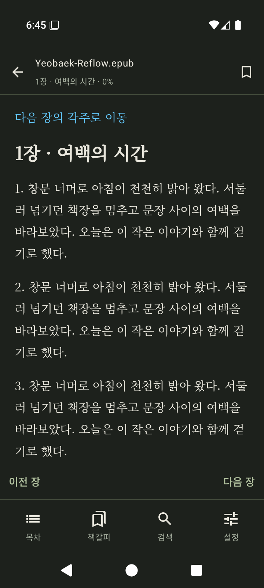
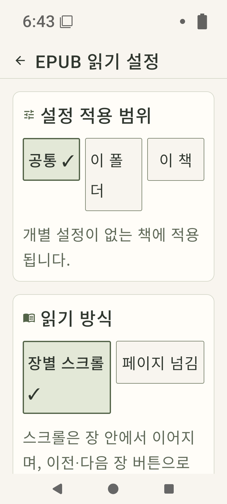
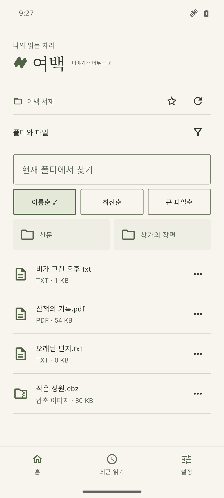
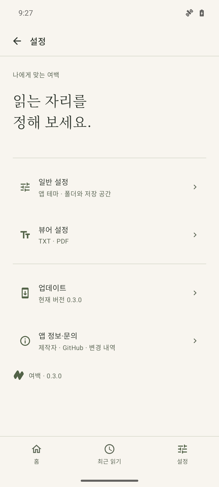
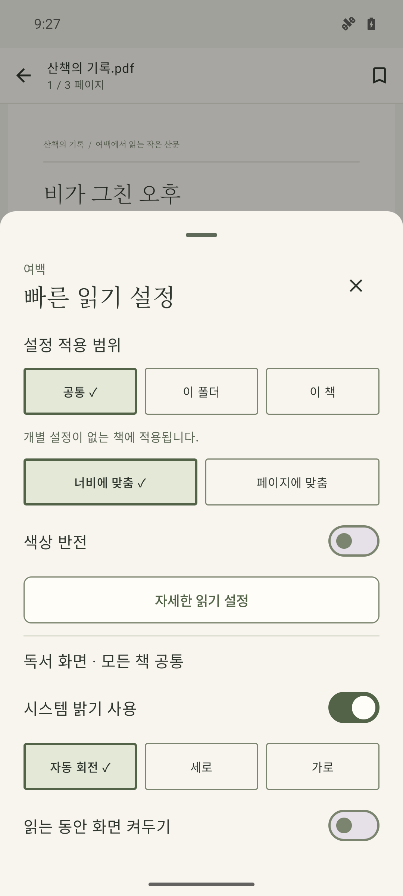

# 여백 화면 안내

[사용자 매뉴얼로 돌아가기](../../README.md)

**v0.4.0 EPUB·설정 화면**과 **v0.3.0 기존 독서 흐름**을 각각 전용 에뮬레이터에서 실행해 촬영했습니다. 산문·PDF·그림은 매뉴얼용 창작 예제입니다. 화면을 누르면 원본 크기로 열립니다.

## v0.4.0 EPUB과 설정

2026-10-17 KST, 최종 release APK를 `yeobaek-release-040`에서 실행했습니다. Android 16(API 36), x86_64, 720×1600, density 320, 기본 fontScale 1.0이며 큰 글씨 화면만 2.0입니다. 앱은 한국어, 시스템 파일 선택기는 영문입니다. PNG 내용을 편집하지 않았습니다. [APK·시험 결과](../releases/0.4.0-verification.md), [EPUB 캡처 출처·해시](0.4.0/epub-manifest.json), [설정 캡처 출처·해시](0.4.0/settings-manifest.json).

<table>
<tr><th>형식별 설정 바로가기</th><th>일반 설정</th></tr>
<tr><td><a href="0.4.0/settings-main.png"></a></td><td><a href="0.4.0/settings-general.png"></a></td></tr>
<tr><th>EPUB 읽기</th><th>EPUB 설정</th></tr>
<tr><td><a href="0.4.0/epub-reader.png"></a></td><td><a href="0.4.0/epub-settings.png"></a></td></tr>
<tr><th>다크 EPUB</th><th>큰 글씨 설정</th></tr>
<tr><td><a href="0.4.0/epub-reader-dark.png"></a></td><td><a href="0.4.0/epub-large-settings.png"></a></td></tr>
</table>

같은 카드 배경을 적용한 [TXT 설정](0.4.0/settings-txt.png) · [PDF 설정](0.4.0/settings-pdf.png) · [이미지 설정](0.4.0/settings-image.png) · [앱 정보](0.4.0/settings-about.png) · [업데이트](0.4.0/settings-updates.png)도 확인할 수 있습니다. [고정 지면 확대](0.4.0/epub-fixed-zoom.png) · [다크 설정](0.4.0/epub-settings-dark.png).

## v0.3.0 기존 독서 흐름

아래 37장은 공개 v0.3.0에서 촬영한 기록입니다. v0.4.0에서 다시 촬영한 결과로 간주하지 않습니다.

## 촬영 조건

| 항목 | 값 |
| --- | --- |
| 앱 | 공개 v0.3.0 · `com.poyal.yeobaek` · versionCode 3 |
| 촬영일 | 2026-10-16 KST |
| 기기 | 전용 AVD `yeobaek-manual-030` · Android 16(API 36) · ARM64 |
| 화면 | 1080×2400 · density 420 · 시스템 글자 배율 1.0 |
| 언어·모양 | 한국어, 라이트 기본 / 다크·세피아 별도 촬영 |
| 이미지 | 실제 `adb exec-out screencap -p` 원본 PNG. 화면 내용을 합성·수정하지 않음 |
| 상태 표시줄 | Android 데모 모드로 시각 9:27, 알림 숨김 |
| 책 원본 | `여백 서재` 아래 창작 TXT·검색 가능한 한글 PDF·이미지 폴더·CBZ |

[공개 APK](https://github.com/poyal/yeobaek/releases/download/v0.3.0/yeobaek-0.3.0.apk)의 SHA-256을 [배포 검증 기록](../releases/0.3.0-verification.md)과 대조하고, 촬영 시 기기에 설치된 APK도 같은 해시인지 검사했습니다.

```text
e8b51930dcac76138b765fb370b714cd469a361517cfa69509f4409a226a8c59
```

화면별 촬영 시각·필수 UI 요소·이미지 해시는 [manifest.json](manifest.json), 예제 원본 해시는 [fixtures.json](fixtures.json)에 있습니다. 원본 책은 APK에 넣지 않았으며 촬영용 기기에만 복사했습니다. 이번 촬영은 사용 흐름 검증이며 성능·TalkBack·실물 기기 검증을 대신하지 않습니다.

## 확인한 내용

- 2026-10-16 16:36~16:39 KST에 `--stage all`을 처음부터 끝까지 실행해 **37장 촬영을 완료**했습니다. TXT·PDF·만화 읽기, 백업 저장·중복 가져오기, 빈 앱 복원·원본 재연결을 포함합니다.
- 모든 PNG의 해시·1080×2400 크기·필수 UI 요소와 예제 원본의 해시를 대조했습니다. 사용자·개발 문서의 로컬 참조 209개도 확인했습니다.
- README와 이 화면 안내를 GitHub Markdown 서식으로 로컬 렌더링해 **1280px·390px** 폭에서 이미지 로딩·목차 앵커·페이지 가로 넘침을 검사했습니다. 각 화면을 직접 검수했으며, 클릭하면 읽을 수 있는 원본 크기로 열립니다.

## 전체 화면

### 처음 연결과 홈

<table>
<tr><th>처음 실행과 시작 폴더 선택</th><th>Android에서 시작 폴더 선택</th></tr>
<tr><td><a href="01-first-open.png"></a></td><td><a href="02-folder-picker.png"></a></td></tr>
</table>

<table>
<tr><th>폴더와 파일이 있는 홈</th><th>읽던 책과 내 폴더가 있는 홈</th></tr>
<tr><td><a href="03-library.png"></a></td><td><a href="35-library-reading.png"></a></td></tr>
</table>

<table>
<tr><th>다크 테마의 홈</th></tr>
<tr><td><a href="36-dark-library.png"></a></td></tr>
</table>

### 읽기·검색·이어 읽기

<table>
<tr><th>메뉴를 펼친 TXT 독서</th><th>메뉴를 숨기고 본문 읽기</th></tr>
<tr><td><a href="04-txt-reader.png"></a></td><td><a href="05-txt-focus.png"></a></td></tr>
</table>

<table>
<tr><th>읽기 위치를 고른 뒤 이동</th><th>문장 위치를 보관하는 책갈피</th></tr>
<tr><td><a href="06-move.png"></a></td><td><a href="07-bookmarks.png"></a></td></tr>
</table>

<table>
<tr><th>본문 검색과 결과 이동</th><th>다음 실행에서 읽던 책 이어 읽기</th></tr>
<tr><td><a href="08-txt-search.png"></a></td><td><a href="15-resume.png"></a></td></tr>
</table>

<table>
<tr><th>최근 읽기에서 책 다시 열기</th><th>현재 폴더 검색·정렬·읽기 상태</th></tr>
<tr><td><a href="16-recent.png"></a></td><td><a href="17-folder-search.png"></a></td></tr>
</table>

<table>
<tr><th>마지막 항목까지 읽은 뒤 나가기</th></tr>
<tr><td><a href="37-reading-end.png"></a></td></tr>
</table>

### 읽기 설정과 테마

<table>
<tr><th>이 책에만 글자 크기 적용</th><th>글꼴과 본문 미리보기</th></tr>
<tr><td><a href="09-quick-settings.png"></a></td><td><a href="10-txt-settings.png"></a></td></tr>
</table>

<table>
<tr><th>세피아 본문</th><th>다크 본문</th></tr>
<tr><td><a href="11-sepia.png"></a></td><td><a href="12-dark-reader.png"></a></td></tr>
</table>

<table>
<tr><th>독서 중 밝기·회전·화면 유지</th><th>글자가 깨질 때 인코딩 미리보기</th></tr>
<tr><td><a href="13-screen-controls.png"></a></td><td><a href="14-encoding.png"></a></td></tr>
</table>

<table>
<tr><th>설정 메뉴</th><th>앱 테마와 시작 폴더</th></tr>
<tr><td><a href="30-settings.png"></a></td><td><a href="31-theme.png"></a></td></tr>
</table>

### PDF

<table>
<tr><th>한글 PDF를 원래 편집 그대로 읽기</th><th>PDF 화면 맞춤과 색상 반전</th></tr>
<tr><td><a href="18-pdf-reader.png"></a></td><td><a href="19-pdf-settings.png"></a></td></tr>
</table>

<table>
<tr><th>PDF 텍스트 검색</th></tr>
<tr><td><a href="20-pdf-search.png"></a></td></tr>
</table>

### 이미지와 만화

<table>
<tr><th>가로로 긴 펼침면 전체</th><th>펼침면 왼쪽부터 읽기</th></tr>
<tr><td><a href="21-comic-spread.png"></a></td><td><a href="22-comic-left.png"></a></td></tr>
</table>

<table>
<tr><th>같은 페이지의 오른쪽 이어 읽기</th><th>미리보며 여백 직접 조절</th></tr>
<tr><td><a href="23-comic-right.png"></a></td><td><a href="24-crop.png"></a></td></tr>
</table>

<table>
<tr><th>페이지 번호와 썸네일로 이동</th><th>폴더 속 이미지들을 한 권으로 읽기</th></tr>
<tr><td><a href="25-thumbnails.png"></a></td><td><a href="34-image-folder.png"></a></td></tr>
</table>

### 백업·복원·유지 관리

<table>
<tr><th>독서 기록 백업 저장과 가져오기</th><th>기존 기록을 유지하는 가져오기 미리보기</th></tr>
<tr><td><a href="26-backup.png"></a></td><td><a href="27-restore-preview.png"></a></td></tr>
</table>

<table>
<tr><th>빈 앱에 독서 기록 가져오기</th><th>기록은 남겨 두고 원본 파일 다시 찾기</th></tr>
<tr><td><a href="28-fresh-restore.png"></a></td><td><a href="29-reconnect.png"></a></td></tr>
</table>

<table>
<tr><th>원본과 독서 기록을 보존하는 캐시 정리</th><th>현재 버전과 업데이트 확인</th></tr>
<tr><td><a href="32-storage.png"></a></td><td><a href="33-update.png"></a></td></tr>
</table>


<a id="recapture"></a>

## 같은 화면 다시 촬영하기

Python 3.12, Android SDK의 platform-tools·emulator·cmdline-tools, JDK 17과 API 36 Google APIs ARM64 이미지를 사용했습니다. 앱은 다시 빌드하지 않고 공개 APK를 설치합니다. 아래 명령은 저장소 루트에서 실행하는 macOS 예시입니다.

### 1. 예제와 도구 준비

```sh
python3 -m venv .tools/manual/venv
.tools/manual/venv/bin/pip install -r scripts/requirements-manual.txt
curl -fL https://github.com/poyal/yeobaek/releases/download/v0.3.0/yeobaek-0.3.0.apk -o .tools/manual/yeobaek-0.3.0.apk
curl -fL 'https://raw.githubusercontent.com/google/fonts/main/ofl/notoserifkr/NotoSerifKR%5Bwght%5D.ttf' -o .tools/manual/NotoSerifKR.ttf
.tools/manual/venv/bin/python scripts/generate-manual-fixtures.py --pdf-font .tools/manual/NotoSerifKR.ttf
```

PDF의 한글 글꼴은 [Noto Serif KR](https://github.com/google/fonts/tree/main/ofl/notoserifkr)이며 [SIL Open Font License](https://github.com/google/fonts/blob/main/ofl/notoserifkr/OFL.txt)를 따릅니다. PDF에는 사용한 글리프를 포함하고 글꼴 파일 자체는 저장소에 추가하지 않습니다. 그림은 앱에 이미 포함된 Noto 명조로 표기합니다.

이 촬영에서 사용한 PDF 글꼴의 SHA-256은 `11f8d5de6f1b79195efba3828aaa2ec95c1178f5ae976fb23c8d53250a9938f3`입니다. 상류 글꼴이 변경되면 예제의 해시가 달라질 수 있으므로 새 촬영 조건을 기록하세요.

### 2. 촬영 전용 AVD 준비

`ANDROID_HOME`은 본인의 SDK 경로로 지정합니다. 기존 테스트 AVD를 재사용하거나 초기화하지 않습니다.

```sh
export ANDROID_HOME="$PWD/.tools/android-sdk"
export ANDROID_USER_HOME="$PWD/.tools/android-home"
export ANDROID_AVD_HOME="$PWD/.tools/avd"
printf 'no\n' | "$ANDROID_HOME/cmdline-tools/latest/bin/avdmanager" create avd --name yeobaek-manual-030 --package 'system-images;android-36;google_apis;arm64-v8a' --device pixel_6 --path "$ANDROID_AVD_HOME/yeobaek-manual-030.avd"
"$ANDROID_HOME/emulator/emulator" -avd yeobaek-manual-030 -port 5590 -no-snapshot -no-audio -no-boot-anim -gpu host -memory 3072
```

에뮬레이터가 켜진 상태에서 별도 터미널로 다음 명령을 실행합니다. 이미 만들어 둔 촬영 전용 AVD라면 생성 명령은 생략합니다.

```sh
.tools/android-sdk/platform-tools/adb -s emulator-5590 wait-for-device
.tools/android-sdk/platform-tools/adb -s emulator-5590 root
.tools/android-sdk/platform-tools/adb -s emulator-5590 wait-for-device
.tools/android-sdk/platform-tools/adb -s emulator-5590 shell setprop persist.sys.locale ko-KR
.tools/android-sdk/platform-tools/adb -s emulator-5590 shell 'stop; start'
```

Android 홈이 다시 나타난 뒤 이어서 실행합니다.

```sh
.tools/android-sdk/platform-tools/adb -s emulator-5590 shell wm size 1080x2400
.tools/android-sdk/platform-tools/adb -s emulator-5590 shell wm density 420
.tools/android-sdk/platform-tools/adb -s emulator-5590 shell settings put system font_scale 1.0
.tools/android-sdk/platform-tools/adb -s emulator-5590 shell svc power stayon true
.tools/android-sdk/platform-tools/adb -s emulator-5590 shell settings put system screen_off_timeout 1800000
.tools/android-sdk/platform-tools/adb -s emulator-5590 shell settings put global window_animation_scale 0
.tools/android-sdk/platform-tools/adb -s emulator-5590 shell settings put global transition_animation_scale 0
.tools/android-sdk/platform-tools/adb -s emulator-5590 shell settings put global animator_duration_scale 0
.tools/android-sdk/platform-tools/adb -s emulator-5590 shell settings put global sysui_demo_allowed 1
.tools/android-sdk/platform-tools/adb -s emulator-5590 shell am broadcast -a com.android.systemui.demo -e command clock -e hhmm 0927
.tools/android-sdk/platform-tools/adb -s emulator-5590 shell am broadcast -a com.android.systemui.demo -e command notifications -e visible false
.tools/android-sdk/platform-tools/adb -s emulator-5590 install .tools/manual/yeobaek-0.3.0.apk
.tools/android-sdk/platform-tools/adb -s emulator-5590 push '.tools/manual/여백 서재' /sdcard/Download/
```

### 3. 조작·촬영·확인

```sh
.tools/manual/venv/bin/python scripts/capture-manual.py --stage all
```

촬영 스크립트는 AVD 이름과 설치 APK의 해시가 다르면 중단합니다. **`start`와 `restore` 단계는 이 전용 AVD의 여백 앱 데이터를 초기화**합니다. `start`는 이전 촬영에서 만든 `여백 서재/yeobaek-manual-backup.json`도 지워 새 백업을 준비합니다. `restore`는 원본 예제와 새 백업을 외부 Download 폴더에 남겨 빈 앱 복원·재연결을 확인합니다. 실제 기기나 다른 AVD에는 실행할 수 없습니다.

각 단계는 `start`, `txt`, `txt-settings`, `txt-resume`, `pdf`, `comic`, `backup`, `restore`, `finish` 순서입니다. 중간부터 다시 진행할 때는 이전 단계의 마지막 화면으로 돌아간 뒤 `--stage 이름`을 사용합니다. `--stage inspect`는 현재 화면의 UI 요소를 출력합니다. 문구·OS 선택기가 바뀌어 실패하면 실제 화면을 확인하고 경로를 수정해야 하며, 누락된 화면을 이전 이미지로 대체하지 않습니다.

원본 PNG와 메타데이터는 이 폴더, UI 구조 XML은 `.tools/manual/ui/`에 저장합니다. 생성한 `.tools/manual/fixtures.json`을 이 폴더의 `fixtures.json`에 복사합니다. 촬영을 마치면 파일 해시·필수 UI·이미지와 설명의 일치 여부 및 모바일·데스크톱 문서 배치를 확인합니다.

```sh
.tools/android-sdk/platform-tools/adb -s emulator-5590 emu kill
```

작업이 끝나면 전용 AVD를 종료합니다. 기존 디자인 시안과 릴리즈 검증 화면은 각자의 폴더에 그대로 보관합니다.
