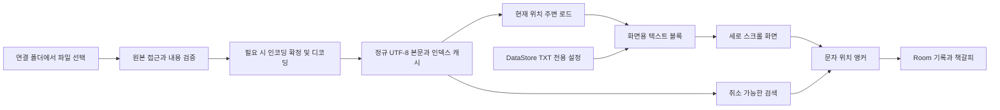

# TXT 뷰어 기술 설계

작성일: 2026-10-13. **제품 설계 기준**입니다. 실제 블록 크기·좌표·캐시 구현은 [구현 문서](implementation.md)에 기록하며 실물 기기 성능 기준은 아직 인수 전입니다.

이 문서는 공통 파일·기록 기반 위에서 동작하는 TXT 엔진의 설계입니다. 서재와 앱 설정은 공통 기능이고, 아래 글꼴·레이아웃 옵션은 TXT에만 적용합니다. [기능·설정 분리](feature-boundaries.md)

## 1. 렌더링 방식 비교

| 방식 | 장점 | 비용 / 한계 | 판단 |
| --- | --- | --- | --- |
| 전체 String + 스크롤 가능한 Text | 가장 간단한 시연 | 파일 전체 디코딩·레이아웃·메모리 비용, 큰 글자 변경 시 부담 | 짧은 실험용 비교군만 사용합니다. |
| Compose LazyColumn + 작은 BasicText | 네이티브 플링, 기본 텍스트 semantics, UI 통합 | 항목 크기·비동기 로드·화면 밖 선택·높이 변화 관리 필요 | **MVP 우선안**입니다. |
| RecyclerView + TextView | View 재사용, Android 텍스트 도구 활용 | Compose와 상태 연결, 두 UI 체계 관리 | M0의 대안입니다. |
| StaticLayout 기반 전용 View | 줄 측정·그리기 제어 | 플링·접근성·선택·좌표 변환을 직접 책임져야 함 | 실제 병목이 확인된 경우에 한정합니다. |
| WebView + TXT의 HTML 변환 | HTML/CSS 타이포그래피 | escaping, DOM 규모, 브리지, 위치 복원, 보안·로드 관리 | TXT 첫 버전에는 채택하지 않습니다. |
| Readium | EPUB 등 전자출판 구조와 기능 | 공식 형식 목록에 TXT 직접 지원이 명시되지 않음 | EPUB 단계에서 검토합니다. |

Lazy 목록의 구성 단위와 안정적인 key, 크기를 가진 placeholder에 대한 공식 설명을 참고했습니다. 나머지 비용 비교와 우선순위는 현재 요구에 대한 설계 판단입니다. [Compose 목록](https://developer.android.com/develop/ui/compose/lists), [StaticLayout](https://developer.android.com/reference/android/text/StaticLayout.Builder), [Readium](https://github.com/readium/kotlin-toolkit)

## 2. 전체 흐름



원본은 OS 폴더에 유지합니다. `content://`를 실제 파일 경로로 바꾸거나 공급자의 스트림이 seek를 지원한다고 가정하지 않습니다. 정규 본문 캐시를 랜덤 접근의 기반으로 삼습니다. [Android 파일 접근](https://developer.android.com/training/data-storage/shared/documents-files), [폴더 연결 설계](folder-library-design.md)

## 3. 폴더 원본·정체성·캐시 확정

### 저장 계층

| 데이터 | 저장 위치 제안 | 삭제·복구 정책 |
| --- | --- | --- |
| 사용자 원본 | 연결 폴더의 document URI | 읽기 전용 접근, 영구 사본 보관 없음 |
| 정규 본문·인덱스 | `cacheDir/text/<contentVersion>/` | 접근 가능한 원본으로 재생성 |
| 연결·문서 메타데이터·위치·책갈피 | Room | 캐시 유실·원본 접근 실패에도 보존 |
| 앱·TXT 표시 기본값 | DataStore의 분리된 모델 | 캐시·본문과 독립적으로 유지 |
| 본문 준비 임시 데이터 | `cacheDir/preparing/<requestId>/` | 취소·실패·재시작 시 해당 요청만 정리; 재시도용 임시 원본은 필요할 때만 사용 |

앱의 연결 정보·기록·캐시는 초기 OS 자동 백업에서 명시적으로 제외하는 안입니다. 앱 삭제 시 앱 데이터는 사라지지만 외부 원본은 유지됩니다. URI 문자열을 백업해도 OS 접근 권한이 자동 이전되는 것으로 간주하지 않습니다. 수동 기록 내보내기는 후속입니다. [Android 백업](https://developer.android.com/identity/data/autobackup)

### ID와 내용 버전

- `bookId`: 독서 기록의 내부 UUID입니다. 소스는 공급자 authority와 불투명 document ID로 연결합니다.
- `sourceHash`: 실제 읽은 원본 스트림 전체의 SHA-256이며 내용 버전을 검증합니다.
- `contentVersion`: 원본 해시·선택한 charset·정규화 알고리즘 버전의 식별자입니다.
- 같은 공급자 문서는 같은 기록에 연결하되 내용이 같은 별도 파일을 해시만으로 자동 병합하지 않습니다.
- 파일명·크기·수정 시각이 같아도 내용은 다를 수 있습니다. 새 열기마다 원본 전체 해시를 확인하며 원본 변경은 새 본문 버전으로 처리합니다.

폴더 조회 상태와 본문 준비 상태를 분리합니다. 본문 작업은 `CheckingSource → ChoosingEncoding(필요 시) → Preparing(캐시 미스) → Committing → Ready`이며 `Cancelled`·`Failed` 경로가 있습니다. 목록에 파일이 보인다고 본문 준비가 완료된 것은 아닙니다.

1. 문서 URI를 읽고 실제 바이트 수로 용량을 제한합니다.
2. 기존 캐시가 있으면 전체 스트림 해시와 버전을 대조합니다. 캐시가 없으면 디코딩·해시·인덱싱을 같은 준비 작업으로 묶습니다.
3. 재판정·내용 변경으로 재독해하면 그때 실제 디코딩한 스트림의 해시로 버전을 확정합니다. 재시도용 임시 원본은 작업 종료 시 삭제합니다.
4. 임시 본문·인덱스의 길이·체크섬·범위를 검증하고 같은 파일시스템의 캐시 경로로 확정합니다.
5. Room에서 해당 책의 본문 버전을 연결하고 이전 위치·책갈피를 보존합니다. 본문 표시 성공 후에만 최근 읽기와 활성 독서 세션을 갱신합니다.
6. 시작 시 미완료 요청의 임시 파일·참조 없는 캐시를 정리합니다. 원본 URI에는 쓰기·삭제 작업을 하지 않습니다.

캐시 파일 확정과 Room 트랜잭션은 하나의 원자적 작업이 아닙니다. 중간 종료와 OS 캐시 회수는 재준비로 복구하되 이전 기록을 지우지 않습니다. 원본 접근 불가 시에는 재연결을 안내합니다. 외부 편집 중 일관된 스냅샷은 공급자가 보장하지 않을 수 있으므로 관측한 변경은 제한 재시도·안내로 처리합니다.

## 4. 인코딩 처리

### 자동 판정 순서

1. 같은 원본에 사용자가 지정한 인코딩이 있으면 우선 사용합니다.
2. BOM을 검사합니다. UTF-32 BOM을 UTF-16 LE로 오인하지 않도록 긴 서명부터 검사하고, 미지원 UTF-32는 안내합니다.
3. UTF-8을 엄격하게 검사합니다. ASCII만 있는 파일은 UTF-8로 읽어도 동일하게 표시됩니다.
4. UTF-8이 유효하지 않으면 CP949·EUC-KR 후보를 엄격한 디코딩으로 검사합니다.
5. 후보가 모호하거나 제어문자 비율이 비정상적이면 미리보기와 수동 선택을 제공합니다.

앞부분 표본은 후보 선별에만 사용합니다. 후보 확정 과정에서 **파일 전체**를 검증하고, 뒤쪽에서 실패하면 원본 URI를 다시 열거나 해당 작업의 제한된 임시 바이트로 재시도합니다. 재독해 시 내용이 바뀌었는지도 확인합니다. 무한 재판정이나 표본만 보고 “인코딩 검증 완료” 처리하지 않습니다.

UTF-16 BOM이 없는 파일은 바이트 패턴으로 후보를 제안할 수 있지만 자동 확정은 보수적으로 합니다. NUL 바이트가 있다는 이유만으로 UTF-16을 바이너리로 거절하지 않습니다. MIME·확장자·대표 바이너리 서명·텍스트 디코딩 가능성을 함께 판단합니다.

### 스트리밍 디코더의 조건

- `CharsetDecoder`의 오류 정책을 명시적으로 `REPORT`로 설정합니다. `�`로 대체한 결과를 정상 성공으로 처리하지 않습니다.
- 입력 버퍼 끝에서 잘린 멀티바이트 시퀀스는 다음 버퍼로 넘깁니다. EOF에서 남은 바이트, `decode(endOfInput=true)`와 `flush()` 결과도 검사합니다.
- CP949는 `x-windows-949`·`MS949` 등 런타임 별칭을 확인하고, 지원 기기의 `Charset.isSupported`와 실제 확장 한글 샘플을 시험합니다.
- CP949/EUC-KR 명칭이나 구현의 관계를 기기 검증 없이 단정하지 않습니다. EUC-KR 입력이 CP949 후보에서도 읽히는 경우 표시 결과와 수동 선택을 기준으로 합니다.
- 손상 부분을 대체하며 읽기는 후속 복구 옵션입니다. 추가할 때 손상 사실·위치를 표시하고 원본을 유지합니다.

오류 처리와 스트리밍 계약은 [CharsetDecoder](https://developer.android.com/reference/java/nio/charset/CharsetDecoder), charset 별칭의 과거 구현 자료는 [AOSP 매핑](https://android.googlesource.com/platform/libcore/+/71f2c75111e87091616f0f3b86bea6c4d345dad1/make/data/charsetmapping/charsets)을 참고했습니다. AOSP 특정 커밋의 목록은 모든 기기의 현재 지원 보장이 아닙니다.

### 정규 본문 규칙 v1

- 파일 처음의 BOM을 제거하고 CRLF·CR을 LF로 통일합니다.
- 버퍼 사이에서 CR과 LF가 나뉘어도 줄 하나로 처리합니다.
- 앞뒤 공백, 탭, 빈 줄, 마지막 줄바꿈의 유무를 보존합니다.
- NFC/NFKC 변환, 문장 합치기, 일괄 trim, 연속 공백 축약을 수행하지 않습니다.
- 따라서 원본 바이트 위치와 정규 본문의 문자 위치는 별개의 좌표입니다.

탭의 시각적 폭은 렌더러 정책을 고정하고 시험합니다. 글리프 미지원은 인코딩 오류와 구분합니다. 옛 강제 줄바꿈 정리는 후속 표시 옵션으로 추가하되 별도 오프셋 매핑을 설계해야 합니다.

## 5. 저장 블록과 화면 블록

### 디스크 저장 블록

정규 본문은 UTF-8 파일로 저장합니다. 고정 길이에 가까운 블록을 사용하고, 인덱스에 아래 정보를 기록합니다.

```text
TextBlockIndex
  ordinal
  canonicalByteStart, canonicalByteLength     // UTF-8 파일 좌표, Long
  utf16Start, utf16Length                     // 본문 논리 좌표, Long
  paragraph/line break metadata               // 압축 또는 제한된 보조 인덱스
  checksum, indexFormatVersion
```

저장 블록은 32~64KiB UTF-8을 출발점으로 시험합니다. 블록 경계는 코드포인트 중간을 자르지 않도록 조절합니다. 화면 문단이 여러 저장 블록에 걸쳐도 이어 읽습니다. 새 줄 하나마다 객체와 DB 행을 만들지 않으며, 빈 줄이 극단적으로 많아도 인덱스 상한을 적용합니다.

파일 전체 인덱스를 Kotlin 객체 목록으로 복제하지 않습니다. 고정 레코드의 디스크 인덱스와 소규모 탐색 캐시를 사용하고, 문자 오프셋으로 이진 탐색합니다. `Long` 전체 오프셋을 현재 블록의 `Int`로 변환할 때 범위를 검사합니다.

### 화면용 블록 — M0의 핵심 검증 대상

일반 본문은 **실제 줄바꿈 경계에서 1,024~4,096 UTF-16 단위 정도로 묶는 안**을 먼저 시험합니다. 빈 줄을 숨기거나 문단 사이에 카드 간격을 추가하지 않습니다. 크기 수치는 고정 규격이 아니라 프레임 측정에 따라 선택할 튜닝값입니다.

매우 긴 문단에는 다음 별도 경로가 필요합니다.

1. 한 번에 레이아웃할 입력 창을 제한합니다. 8,192 UTF-16 단위를 초기 상한으로 시험합니다.
2. 다음 문자가 줄바꿈에 영향을 줄 수 있으므로 뒤쪽 문맥을 포함하여 측정하고 마지막 불완전 줄은 다음 창에 넘깁니다.
3. 실제 측정된 완성 줄 경계에서 표시 조각을 확정합니다. 단순히 N글자마다 `Text`를 나누어 인위적인 줄바꿈을 만들지 않습니다.
4. 원본에 없는 문단 간격·들여쓰기·마지막 줄 패딩을 조각 경계에 넣지 않습니다. 원본 LF와 화면 줄바꿈을 구분합니다.
5. 연속 조각의 문자 범위가 공백 없이 이어지는지 확인하고, 조합형 한글·결합문자·이모지·혼합 방향 문장으로 경계와 재측정 결과를 비교합니다.

이 경로가 모든 스크립트에서 통째로 측정한 문단과 동일하다고 보장하지는 않습니다. 문단 전체를 고려하는 줄바꿈·하이픈·양쪽 정렬을 초기 기본값에서 피하고, 한글·라틴 혼합의 경계 정확성을 M0에서 필수 검증합니다. 범용 RTL 문단 최적화는 별도 범위입니다. 병적인 결합문자열에서 안전한 분할점을 찾지 못하면 무제한 측정 대신 제한 안내로 끝냅니다.

문자 경계는 surrogate pair만 피하는 것으로 충분하지 않습니다. 사용자가 한 글자로 인식하는 결합 단위는 [Unicode 텍스트 분할 규칙](https://www.unicode.org/reports/tr29/)을 기준으로 시험합니다. OS별 분할 도구가 최신 Unicode의 모든 이모지를 동일하게 처리한다고 가정하지 않습니다.

### 간격의 정확성

블록 끝 LF를 렌더링한 뒤 다음 블록에 추가 padding을 넣으면 줄이 이중으로 벌어질 수 있습니다. 정규 본문에서 각 LF·빈 줄의 소유 범위를 명시하고, 인접 블록을 합쳐 표시한 기준 화면과 줄 기준선 간격을 비교합니다. 문자 누락 0, 중복 0, 비의도 간격 0이 목표입니다.

### 화면 항목과 멀리 이동하기

저장 블록 번호를 그대로 `LazyColumn` 항목 번호로 사용하지 않습니다. 화면 분할 결과에는 본문 문자 범위와 `layoutKey`를 붙이고, 현재 창 앞뒤에 항목을 추가하거나 제거할 때 보이는 문자 앵커를 유지합니다. 전체 높이를 알아야 하는 스크롤바 대신 문자 진행률 슬라이더를 사용합니다.

긴 한 문단의 중간으로 곧바로 이동하면 앞에서부터 줄을 나눈 결과를 즉시 알 수 없습니다. 같은 레이아웃에서 만든 줄 시작 체크포인트를 재사용하는 안을 시험하되, 새 글꼴·폭에서는 무효화합니다. 체크포인트가 없는 곳의 앞쪽 측정 비용과 역방향 분할의 일관성은 **M0에서 해결할 미확정 항목**입니다. 임의의 문자를 새 줄 시작으로 삼아 정확한 복원이라고 처리하지 않습니다.

시제품은 줄바꿈 없는 1MiB 파일의 80% 지점으로 이동한 뒤 위아래 스크롤·글자 크기 변경·재실행을 검사합니다. 이때 준비 시간과 메모리를 따로 기록하고, 제한 안에서 정확한 경계를 만들 수 없다면 렌더러 또는 긴 문단 지원 정책을 수정한 뒤 M0를 마칩니다.

## 6. 스크롤·선행 로드·캐시

일반 블록의 key는 본문 버전과 시작 문자 오프셋을 사용합니다. 긴 문단의 화면 분할은 레이아웃에 따라 달라질 수 있으므로 영속 기록의 ID로 사용하지 않습니다.

- 디스크 읽기·디코딩은 I/O 작업으로, 검색·인덱싱은 제한된 CPU 작업으로 분리합니다.
- 조합 함수, item provider, 스크롤 콜백에서 파일 읽기나 DB 쓰기를 수행하지 않습니다.
- 기본은 현재 화면과 진행 방향 2~3화면, 반대 방향 1화면 정도를 선행 준비하는 실험안입니다.
- 프리페치 취소와 방향 전환을 지원하고, 화면 밖 작업이 사용자 입력을 앞서지 않게 합니다.
- 높이 0의 placeholder를 사용하지 않습니다. 예상 높이를 쓸 경우 실제 높이 교체 후 앵커를 보정하며, 읽는 중 반복 보정으로 화면이 튀는지도 검사합니다.
- 멀리 이동할 때는 대상 위치의 앞뒤 블록을 먼저 준비하고 한 번에 전환합니다. 긴 거리를 자동 스크롤 애니메이션으로 통과하지 않습니다.

Compose의 텍스트 측정 객체와 폰트 resolver가 임의 스레드에서 공유 가능하다고 가정하지 않습니다. M0에서는 텍스트 I/O와 파싱을 먼저 분리하고, 레이아웃의 백그라운드 처리 여부는 선택한 API의 스레드 계약과 측정 결과로 결정합니다.

| 자원 | 초기 예산 제안 | 조정 기준 |
| --- | --- | --- |
| 디코딩된 본문 | 8MiB 이내 LRU | 현재 화면은 유지하며 오래된 블록부터 제거합니다. |
| 화면 레이아웃 | 주변 화면 기준, 약 24개 항목부터 시험 | 매우 큰 항목도 있으므로 개수와 관측 메모리를 함께 봅니다. |
| 인덱스 탐색 메모리 | 4MiB 이내 | 전체 문단 메타데이터 객체화를 피합니다. |
| 파생 디스크 캐시 | 비활성 책 포함 256MiB 정리 목표 | 활성 책은 보호합니다. 활성 책의 본문·인덱스만으로 목표를 넘으면 해당 책의 개별 안전 한도까지 허용하고 다른 책의 캐시를 정리합니다. |

테마 색만 바뀌면 가능한 경우 기존 레이아웃을 유지합니다. 글꼴·글자 크기·폭·줄간격·density·fontScale·문단 규칙은 레이아웃 키에 포함합니다. 비동기 글꼴이 뒤늦게 바뀌지 않도록 첫 버전은 즉시 사용 가능한 폰트를 우선합니다. [TextMeasurer의 캐시 설명](https://developer.android.com/reference/kotlin/androidx/compose/ui/text/TextMeasurer?authuser=8)

## 7. 문자 앵커로 읽기 위치 복원

```text
TxtLocator
  schemaVersion
  bookId
  contentVersion
  utf16Offset: Long
  lineFraction: Float?       // 기존 줄에서 가려진 비율, 동일 레이아웃에서만 사용
  layoutKey: String?
  contextBefore, contextAfter // 재해석 시의 제한된 문맥, 로컬에만 저장
```

영속 좌표는 정규 본문의 UTF-16 code unit 기준입니다. “문자 수”라는 UI 표현과 코드포인트·사용자가 인식하는 글자 수는 다를 수 있습니다. 전체 오프셋은 `Long`, `TextLayoutResult` 안의 로컬 오프셋은 `Int`입니다.

### 저장

1. 안전 영역 아래에서 처음 보이는 본문 항목과 그 `TextLayoutResult`를 구합니다.
2. 실제 스크롤 offset과 padding을 반영해 상단과 만나는 줄을 찾습니다.
3. 해당 줄의 시작 오프셋을 본문 전체 오프셋으로 변환합니다.
4. 같은 레이아웃 복원을 위한 줄 내부 가려진 비율을 보조값으로 저장합니다.

매 프레임 DB에 쓰지 않습니다. 메모리 상태를 갱신하고 스크롤 중에는 최대 1초 간격으로 저장, 정지 후 약 300ms에 마지막 값을 저장하는 안을 사용합니다. 화면 종료와 앱 백그라운드 전환에서도 최종 저장을 시도합니다. 연속 스크롤에는 debounce만 쓰면 저장이 계속 미뤄지므로 주기 저장을 함께 둡니다.

종료 콜백만으로 완전한 저장을 보장하지 않습니다. 강제 종료 직전에 아직 기록하지 못한 최대 저장 주기만큼의 손실 가능성을 인정하고 시험합니다. 저장 요청 순번·세션 ID를 비교해 이전 화면의 늦은 저장이 새 위치를 덮지 못하게 합니다.

### 복원

1. 책 ID와 본문 버전을 확인합니다.
2. 인덱스에서 오프셋을 포함하는 저장 블록을 찾고 주변 본문을 읽습니다.
3. 현재 설정·실제 콘텐츠 폭으로 해당 문자를 포함하는 줄을 측정합니다.
4. 그 줄을 안전 영역 상단으로 배치합니다. 같은 레이아웃일 때만 줄 내부 비율을 재사용합니다.
5. 위치가 확정될 때까지 임시 스크롤 위치를 영속 저장하지 않습니다.

설정 변경은 `앵커 캡처 → 이전 작업 취소 → 새 layout generation → 필요한 주변 영역 재측정 → 앵커 복원` 순서입니다. 회전·분할 화면·폴더블 폭 변화·시스템 글자 확대도 같은 경로를 이용합니다.

### 인코딩 변경

새 인코딩으로 본문 버전이 바뀌면 기존 오프셋을 그대로 쓰지 않습니다. 이전 위치·책갈피를 보관하고 문맥이 새 본문에서 유일하게 발견될 때만 이전합니다. 찾지 못하거나 후보가 여러 개면 비슷한 진행률을 제안하되 정확한 복원이라고 표시하지 않습니다. 이전 책갈피를 조용히 삭제하지 않습니다.

외부 편집으로 원본 해시가 달라진 경우에도 같은 버전 이전 절차를 적용합니다. 위치는 본문 버전별로 보존하여 준비 실패·이전 취소가 과거 위치를 덮지 않게 합니다. 새 실행에서는 [이어 읽기 확인 흐름](startup-resume-flow.md)이 먼저 열기 여부를 결정합니다.

## 8. 최소 데이터 모델

| 모델 | 핵심 필드 | 정책 |
| --- | --- | --- |
| FolderConnection | id, treeUri, authority, rootDocumentId, connectionState | 설정한 시작 폴더와 OS 읽기 권한을 함께 검증합니다. |
| Book | id, authority, documentId, documentUri, folderConnectionId, format, displayName, observedSize?, observedModifiedAt?, lastVerifiedHash?, lastOpenedAt? | 파일명·내용 해시를 책의 유일한 ID로 사용하지 않습니다. |
| TextContent | bookId, charset, normalizationVersion, contentVersion, utf16Length, indexVersion | 정규화·인덱스 버전은 DB 버전과 분리합니다. |
| ReadingPosition | bookId, contentVersion, locatorVersion, locatorPayload, sessionRevision, updatedAt, completedAt? | 버전별 위치를 보존합니다. 진행률은 유일한 복원 좌표가 아닙니다. |
| ReadingSessionState | candidateBookId?, sessionRevision, updatedAt | 독서 중 종료한 다음 새 실행의 확인 후보입니다. |
| Bookmark | id, bookId, locatorVersion, locatorPayload, excerpt, createdAt | 본문과 버전을 함께 묶습니다. |
| AppPreferences | uiTheme, startFolderConnectionId | 앱 UI·시작 위치용이며 TXT 본문 색상과 독립입니다. |
| TxtPreferences | font, size, lineHeight, margin, colorScheme | TXT끼리 공유하는 기본값입니다. 책별 표시 override는 후속입니다. |

Room은 서재 메타데이터와 관련 기록을 관리하고 DataStore는 앱·형식별 작은 설정을 관리합니다. TXT 표시 설정의 갱신·초기화는 AppPreferences나 향후 PdfPreferences·ImagePreferences를 변경하지 않습니다. 책별 charset은 TextContent에 남겨 표시 설정 초기화와 분리합니다. TXT 전체를 DB의 JSON 한 행이나 SavedStateHandle에 저장하지 않습니다. [Room](https://developer.android.com/training/data-storage/room), [DataStore](https://developer.android.com/topic/libraries/architecture/datastore)

서재 목록·현재 책·책갈피를 별도 Flow로 조회합니다. 매 읽기 위치 저장마다 모든 책과 기록을 다시 로드하지 않습니다. 읽기 본문은 창 단위로 유지합니다. [Android 개발 기준](android-development.md)

## 9. 검색·진행률·동시성

검색은 정규 본문에 대해 수행하며 원본 바이트에서 찾지 않습니다. 첫 버전은 대소문자 구분이 있는 정확한 부분 문자열입니다. 질의 길이는 256 code point 이내로 제한하는 안입니다.

청크 사이에 걸친 문자열을 놓치지 않도록 KMP 같은 상태를 유지하는 스트리밍 검색이나 길이를 검증한 overlap을 사용합니다. 결과는 본문 오프셋으로 저장하고 처음 100건을 우선 표시하며 추가 결과를 점진적으로 제공합니다. 전체 결과를 제한 없이 리스트에 쌓지 않습니다. Room FTS만으로 임의의 한국어 부분 문자열 검색을 해결한다고 가정하지 않습니다.

진행률은 현재 문자 오프셋 / 전체 UTF-16 길이로 계산합니다. 100%는 본문 끝 도달 상태와 함께 판정하여 마지막 줄 시작 위치가 99.x%인 문제를 처리합니다. 원본 바이트 비율·스크롤 픽셀 비율과 혼용하지 않습니다.

폴더 조회·본문 준비·검색·위치 이동·설정 변경마다 요청 ID를 부여합니다. UI 반영 전에 `bookId + contentVersion + requestId/layoutGeneration`을 비교하고, 취소된 작업의 늦은 결과를 버립니다. I/O 예외 처리에서도 `CancellationException`은 취소로 전파합니다. 화면을 닫으면 검색·선행 로드를 취소하고 파일 핸들을 닫습니다.

## 10. 접근성 및 복구 기준

`BasicText`의 텍스트 semantics를 유지하며 책 전체를 하나의 거대한 접근성 노드로 합치지 않습니다. TalkBack이 블록 경계를 넘어서 순서대로 읽는지 검증합니다. 메뉴 버튼에는 이름·상태·최소 터치 영역을 제공합니다. Custom Canvas를 도입하면 이에 상응하는 접근성 구현 비용도 포함해야 합니다. [Compose semantics](https://developer.android.com/develop/ui/compose/accessibility/semantics)

`SelectionContainer`로 화면 밖까지 이어지는 전체 선택이 자동 해결되지는 않습니다. 따라서 첫 버전의 북마크는 범위 선택과 독립적이고, 검색 강조는 지정 범위의 일시적 표시입니다. [선택 API](https://developer.android.com/reference/kotlin/androidx/compose/foundation/text/selection/SelectionContainer.composable)

최종적으로 외부 원본은 사용자가 관리하며 앱은 읽기 전용으로 접근합니다. 정규 본문·인덱스·레이아웃은 재생성 대상, 위치·책갈피는 앱이 보존할 사용자 데이터입니다. 이 세 종류의 수명을 섞지 않는 것이 복구 설계의 기준입니다.
